# Data Flow Specification

## 1. Document Purpose

This document describes the data flows and interaction sequences within the 3D generation web application.

It defines:

- User authentication flow.
- Project creation flow.
- Image upload flow.
- Object generation flow.
- Scene reconstruction flow.
- Transactional Outbox workflow.
- Celery message delivery.
- Worker execution.
- Task status updates.
- Generation result persistence.
- GLB downloading.
- Project deletion and file cleanup.
- Failure recovery.
- Data consistency requirements.

This document complements:

- `system_architecture.md`
- `api_contracts.md`

It describes HOW information moves between application components and HOW the system maintains consistency.

## 2. General Data Flow Principles

### 2.1. Data Ownership

Each component must have clearly defined data ownership.

| Component | Data Responsibility |
|---|---|
| Frontend | Temporary interface state and local upload selection |
| FastAPI | Application operations and authorization |
| PostgreSQL | Persistent metadata and lifecycle states |
| Redis | Background message transport |
| Outbox Dispatcher | Publishing persisted background events |
| Celery Workers | Asynchronous processing |
| File Storage | Binary files and processing artifacts |
| TripoSR | Individual object reconstruction |
| COLMAP | Camera estimation and sparse reconstruction |
| OpenMVS | Dense reconstruction and mesh texturing |
| Three.js | Browser-side asset visualization |

### 2.2. Data Consistency

The following rules must always be respected:

- PostgreSQL is the source of truth for application state.
- Redis is not the authoritative task status store.
- Generation workers must process immutable task inputs.
- Every generation attempt must have its own identifier.
- Every task must be associated with one project.
- Every successful result must reference its generating task.
- File storage references must resolve to valid files.
- Previous successful results must remain available until a new result is successfully registered.
- Project ownership must be validated before accessing associated data.

### 2.3. Data Flow Types

The application uses several communication patterns:

**Synchronous Request/Response**

Used for ordinary frontend/backend interactions.

**Asynchronous Message Delivery**

Used for background generation and file cleanup.

**Shared Persistent Storage**

Used for transferring photographs and generated assets between services.

**Database Transactions**

Used for operations that modify multiple related records.

**Polling**

Used by the frontend to retrieve generation status.

## 3. Authentication Data Flow

### 3.1. Registration

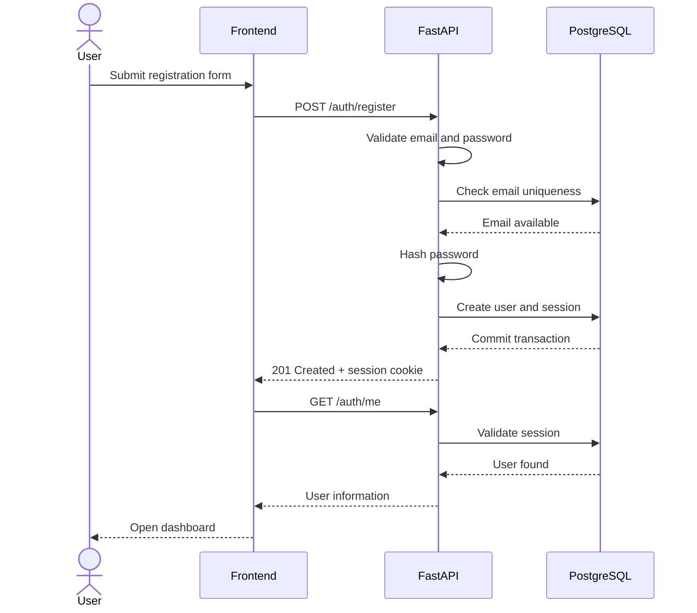

### 3.2. Registration Data

Input:

- Email.
- Password.

Processing:

1. Validate request.
2. Normalize email.
3. Verify that email is not already registered.
4. Hash password.
5. Create user.
6. Create session.
7. Store session token hash.
8. Commit transaction.
9. Set HttpOnly cookie.
10. Return user information.

The registration and session creation operation must be transactional.

### 3.3. Login

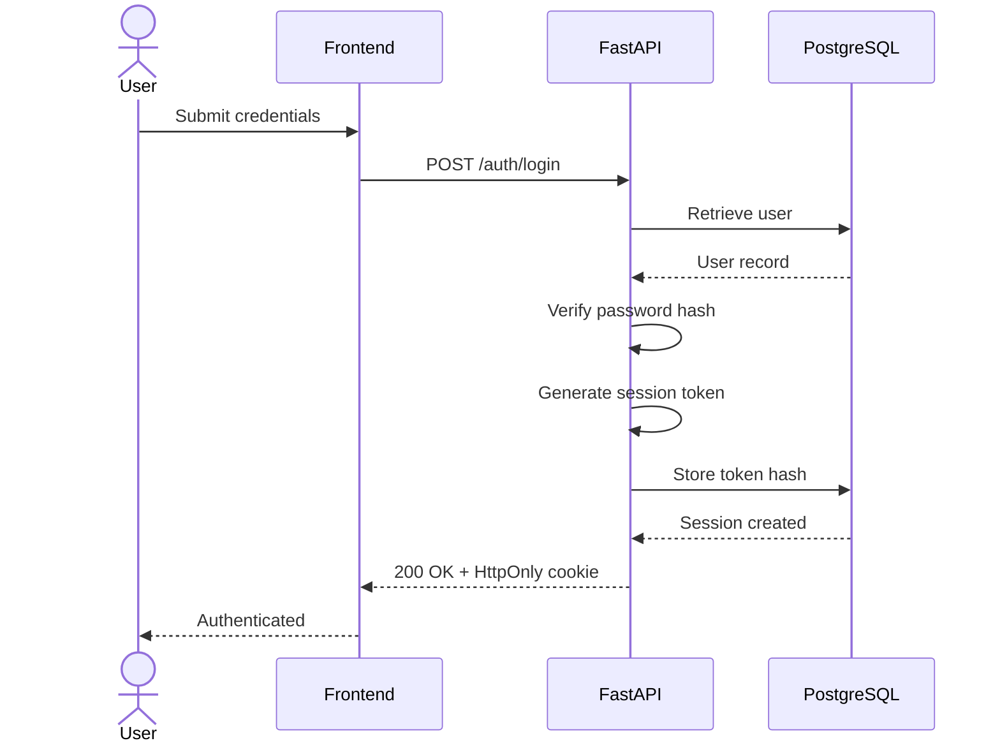

### 3.4. Authenticated Requests

For protected API operations:

1. Browser sends the session cookie.
2. FastAPI extracts the session token.
3. Backend hashes the token.
4. Backend retrieves the corresponding session.
5. Backend verifies expiration and revocation.
6. Backend identifies the authenticated user.
7. The endpoint verifies resource ownership where applicable.
8. The operation proceeds.

For state-changing requests, validate the session-bound CSRF token.

### 3.5. Logout

1. Frontend sends logout request.
2. Browser includes the session cookie.
3. Frontend includes the CSRF header.
4. Backend validates the session.
5. Backend revokes the session.
6. Backend clears the session cookie.
7. Frontend clears authentication state.

## 4. Project Creation Data Flow

### 4.1. Project Creation

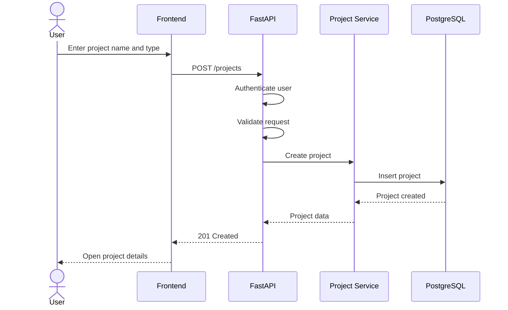

### 4.2. Processing Steps

1. User selects generation type.
2. User enters project name.
3. Frontend validates required input.
4. Frontend sends project creation request.
5. Backend authenticates the user.
6. Backend validates project type and name.
7. Backend creates a project UUID.
8. Backend inserts the project with status CREATED.
9. Backend commits the transaction.
10. Backend returns project information.
11. Frontend navigates to project details.

Project creation must not automatically initiate generation.

## 5. Image Upload Data Flow

### 5.1. General Workflow

The application uses individual upload requests for each image.

For Object Generation, only one image is accepted.

For Scene Reconstruction, multiple images are uploaded through separate requests.

### 5.2. Upload Sequence

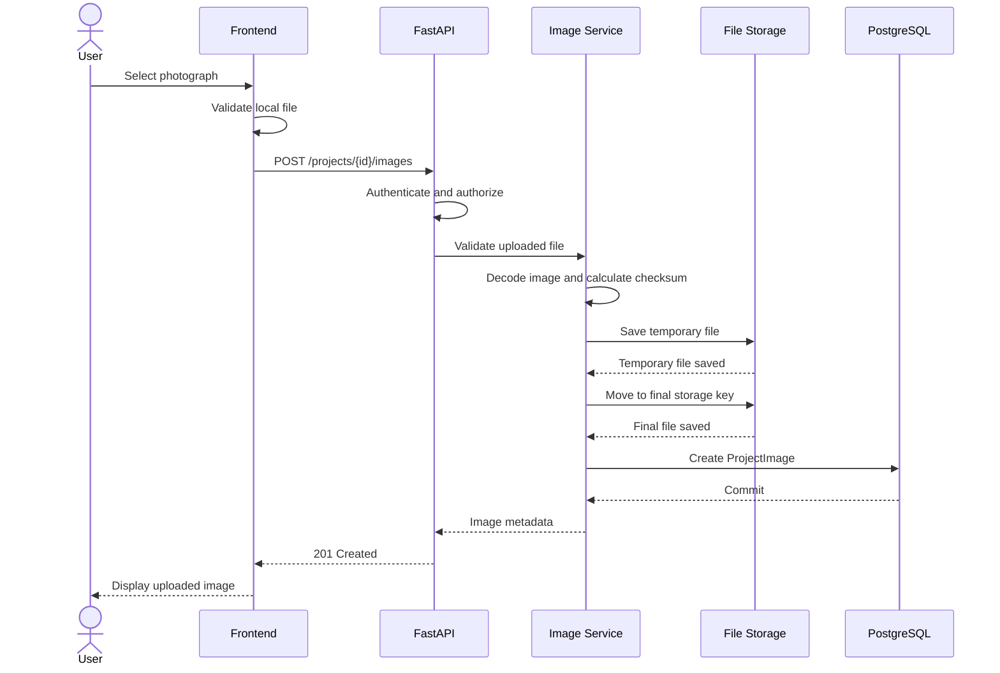

### 5.3. Upload Lifecycle

The backend must:

1. Authenticate the user.
2. Verify project ownership.
3. Verify project state.
4. Validate extension and MIME type.
5. Decode the actual image.
6. Validate dimensions and file size.
7. Calculate SHA-256.
8. Generate a unique image identifier.
9. Save the file to temporary storage.
10. Move the file to its final storage key.
11. Create ProjectImage metadata.
12. Commit the database transaction.
13. Return image metadata.

### 5.4. File and Database Consistency

The filesystem and PostgreSQL do not share an atomic transaction.

Therefore:

- Save the image to storage first.
- Create the database reference only after the file is safely stored.
- If database persistence fails, schedule or perform cleanup of the stored file.
- Do not expose incomplete uploads as valid ProjectImage records.

### 5.5. Multiple Image Upload

For Scene Reconstruction:

```text
Upload image 1
    |
    v
Validate and store
    |
    v
Create ProjectImage 1
    |
    v
Upload image 2
    |
    v
Validate and store
    |
    v
Create ProjectImage 2
    |
    v
Upload remaining images
```

Each image must have an independent upload result.

A failed upload must not invalidate photographs that were already stored successfully.

Generation must remain unavailable until all required uploads have completed successfully.

### 5.6. Source Image Immutability

Once a generation task has been created, its input image snapshot must remain unchanged.

The system must not allow deletion or modification of source images referenced by existing generation history.

For the MVP, source image editing is not required after generation has started.

---

## 6. Generation Initiation Data Flow

### 6.1. Overview

Starting generation is a critical operation because it modifies several database entities and schedules asynchronous execution.

Use the Transactional Outbox pattern.

### 6.2. Generation Request Sequence

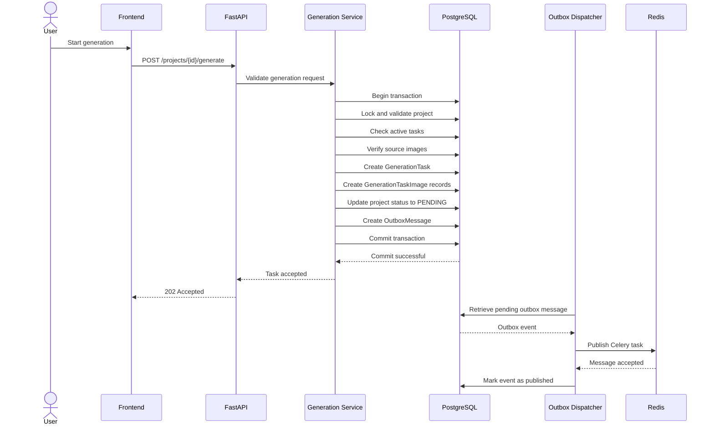

### 6.3. Atomic Database Transaction

The following operations must occur in one PostgreSQL transaction:

1. Lock or safely coordinate access to the project.
2. Validate project status.
3. Verify source image availability.
4. Check active generation tasks.
5. Insert GenerationTask.
6. Insert GenerationTaskImage references.
7. Update Project status to PENDING.
8. Insert OutboxMessage.
9. Commit transaction.

If the transaction fails, none of these operations must remain partially committed.

### 6.4. GenerationTask Creation

Each generation attempt receives a unique UUID.

The task contains:

- Project ID.
- Task type.
- Initial status.
- Request idempotency key.
- Request fingerprint.
- Generation parameters.
- Source image snapshot.
- Creation timestamp.

The task type must match the project type.

### 6.5. Source Image Snapshot

Before dispatching the task, record all source images in GenerationTaskImage.

Example:

```text
GenerationTask
    |
    +---- GenerationTaskImage 1
    |
    +---- GenerationTaskImage 2
    |
    +---- GenerationTaskImage 3
```

The worker must use these records to retrieve input files.

It must not load an arbitrary current image list from the project.

### 6.6. Transactional Outbox

The OutboxMessage represents a persistent request to dispatch background work.

A generation event must contain:

```json
{
  "event_id": "uuid",
  "event_type": "generation.requested",
  "schema_version": 1,
  "task_id": "uuid",
  "project_id": "uuid",
  "task_type": "OBJECT",
  "created_at": "2026-11-05T12:00:00Z"
}
```

The event payload must contain identifiers and metadata rather than large binary images.

### 6.7. Outbox Table

The outbox table is defined in `05_database_specification.md`, Section 13.

It stores:

- Event identity and type.
- Aggregate type and identifier.
- Payload and schema version.
- Publishing status and attempts.
- Availability time.
- Lock metadata (`locked_at`, `locked_by`).
- Publication timestamp.
- Last error.
- Creation timestamp.

Do not duplicate the schema definition here. The migration and ORM model must follow the database specification.

### 6.8. Dispatcher Concurrency

The dispatcher must safely claim pending messages.

Use PostgreSQL row locking with `FOR UPDATE SKIP LOCKED` or an equivalent safe claiming mechanism.

This allows multiple dispatcher instances without processing the same database row concurrently under normal operation.

The dispatcher must implement lock expiration or recovery for messages left in PROCESSING after unexpected termination.

The Outbox Dispatcher must not hold a PostgreSQL row lock during the network call to Redis.

Correct sequence:

1. Atomically claim the message with `FOR UPDATE SKIP LOCKED`.
2. Persist the `PROCESSING` state and the lease (`locked_at`, `locked_by`, `attempts`).
3. Commit the PostgreSQL transaction.
4. Publish the message to Redis.
5. Mark the message `PUBLISHED` in a separate transaction.
6. Restore an expired message after an abnormal termination.

Holding a transaction open across a Redis call would extend lock duration and degrade system behavior under load.

---

## 7. Message Delivery and Celery Execution

### 7.1. Queue Routing

The outbox event type, together with the task type it carries, determines the target processing queue.

| Event Type | Task Type | Queue | Worker |
|---|---|---|---|
| generation.requested | OBJECT | object_generation | Object Worker |
| generation.requested | SCENE | scene_reconstruction | Scene Worker |
| cleanup.requested | CLEANUP | file_cleanup | Cleanup Worker |

Event types and their payload contracts are enumerated in `05_database_specification.md`, Section 13.7.

### 7.2. Celery Task Message

Example object generation message:

```json
{
  "task_id": "generation-task-uuid",
  "project_id": "project-uuid",
  "task_type": "OBJECT"
}
```

Example scene reconstruction message:

```json
{
  "task_id": "generation-task-uuid",
  "project_id": "project-uuid",
  "task_type": "SCENE"
}
```

The Celery task ID must equal `GenerationTask.id`. This lets repeated deliveries be correlated to one logical task.

Do not generate an unrelated random Celery task identifier.

### 7.3. Delivery Semantics

The outbox dispatcher provides at-least-once publication.

It cannot atomically commit a Redis publication and a PostgreSQL update in one transaction.

Therefore, a dispatcher may publish a task and terminate before marking the outbox event as PUBLISHED.

The event may consequently be published again.

Workers must be idempotent.

Duplicate message delivery must not produce conflicting results.

### 7.4. Worker Claiming

When receiving a message, a worker must:

1. Retrieve the GenerationTask.
2. Verify that its status is PENDING.
3. Atomically transition the task to PROCESSING.
4. Update the project status where appropriate.
5. Store `worker_id`, `heartbeat_at` and `lease_expires_at`.
6. Start processing.

A task may only be claimed through an atomic conditional database transition from `PENDING` to `PROCESSING`.

The worker must store its identifier and lease expiration.

A duplicate delivery must not start another processing instance while a valid worker lease exists.

The transition must use a conditional database update or transaction with appropriate locking.

If another worker has already claimed the task, the duplicate delivery must not start another inference or reconstruction operation.

### 7.5. Worker Initialization Failure

If the worker cannot initialize its processing environment:

- Do not silently discard the message.
- Record worker readiness or initialization failure.
- Ensure that unstarted tasks remain recoverable.
- Do not mark a task COMPLETED.

---

## 8. Object Generation Data Flow

### 8.1. Overview

Object generation uses one source photograph and TripoSR.

### 8.2. Sequence Diagram

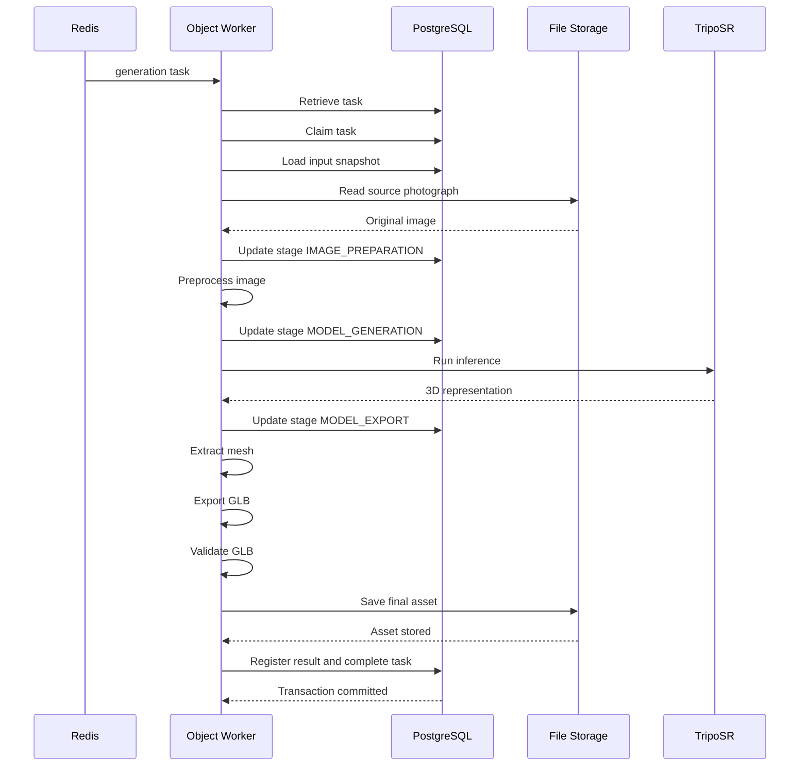

### 8.3. Processing Steps

**Step 1. Input Retrieval**

Retrieve the generation task and its associated source image snapshot.

Verify that the source file exists.

**Step 2. Working Directory**

Create an isolated directory:

```text
/data/projects/{project_id}/working/object/{task_id}/
```

**Step 3. Image Preprocessing**

Perform:

- Image decoding.
- EXIF orientation correction.
- Background removal.
- Foreground cropping.
- Resizing.
- Model input preparation.

**Step 4. Inference**

Execute TripoSR using the configured device.

**Step 5. Mesh Extraction**

Extract the 3D mesh and validate geometry.

**Step 6. Export**

Export the model in GLB format.

**Step 7. Asset Validation**

Verify the exported file.

**Step 8. Persistence**

Move the final GLB asset into its permanent storage location.

Register GenerationResult in PostgreSQL.

**Step 9. Completion**

Update task status and project status.

### 8.4. Object Processing Stages

```text
IMAGE_PREPARATION
MODEL_GENERATION
MODEL_EXPORT
RESULT_VALIDATION
```

`COMPLETED` is a task status, not a stage.

The exact stage identifiers must be consistent with `06_object_generation.md`.

---

## 9. Scene Reconstruction Data Flow

### 9.1. Overview

Scene Reconstruction uses multiple photographs and a multi-stage photogrammetry pipeline.

### 9.2. Sequence Diagram

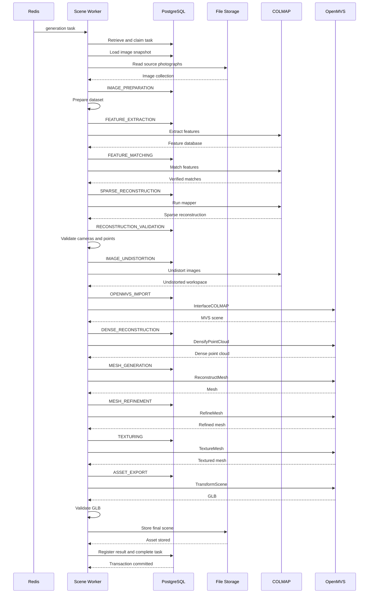

### 9.3. Processing Steps

**Step 1. Input Retrieval**

Retrieve the exact photograph collection associated with the GenerationTask.

**Step 2. Dataset Preparation**

Create an isolated reconstruction workspace.

```text
/data/projects/{project_id}/working/scene/{task_id}/
```

Copy or safely reference the original images.

**Step 3. Preflight Validation**

Verify:

- Required image count.
- Image readability.
- Image uniqueness.
- Storage accessibility.
- Available working storage.

**Step 4. Feature Extraction**

Execute COLMAP feature extraction.

**Step 5. Feature Matching**

Execute the configured matching strategy.

**Step 6. Sparse Reconstruction**

Execute COLMAP mapper.

**Step 7. Reconstruction Validation**

Inspect:

- Registered cameras.
- Reconstructed points.
- Camera parameters.
- Reconstruction components.

Stop if a usable sparse model cannot be produced.

**Step 8. Image Undistortion**

Prepare the dense workspace for OpenMVS.

**Step 9. OpenMVS Import**

Convert the COLMAP reconstruction into the OpenMVS scene format.

**Step 10. Dense Reconstruction**

Generate the dense point cloud.

**Step 11. Mesh Generation**

Reconstruct polygonal geometry.

**Step 12. Mesh Refinement**

Improve the reconstructed surface.

**Step 13. Texture Generation**

Generate UV coordinates, texture atlases and associated materials.

**Step 14. GLB Export**

Export the textured scene.

**Step 15. Asset Validation**

Verify geometry, materials and textures.

**Step 16. Persistence**

Store the final GLB and register result metadata.

### 9.4. Scene Processing Stages

The persistent task stages must match the scene specification:

```text
IMAGE_PREPARATION
FEATURE_EXTRACTION
FEATURE_MATCHING
SPARSE_RECONSTRUCTION
RECONSTRUCTION_VALIDATION
IMAGE_UNDISTORTION
OPENMVS_IMPORT
DENSE_RECONSTRUCTION
MESH_GENERATION
MESH_REFINEMENT
TEXTURING
ASSET_EXPORT
RESULT_VALIDATION
```

`COMPLETED`, `FAILED` and `CANCELLED` are task statuses, not stages.

---

## 10. Generation Result Persistence

### 10.1. General Requirements

A generation result must be registered only after a valid asset has been stored.

Filesystem operations and database transactions cannot be committed atomically.

Use a safe persistence sequence.

### 10.2. Result Registration Flow

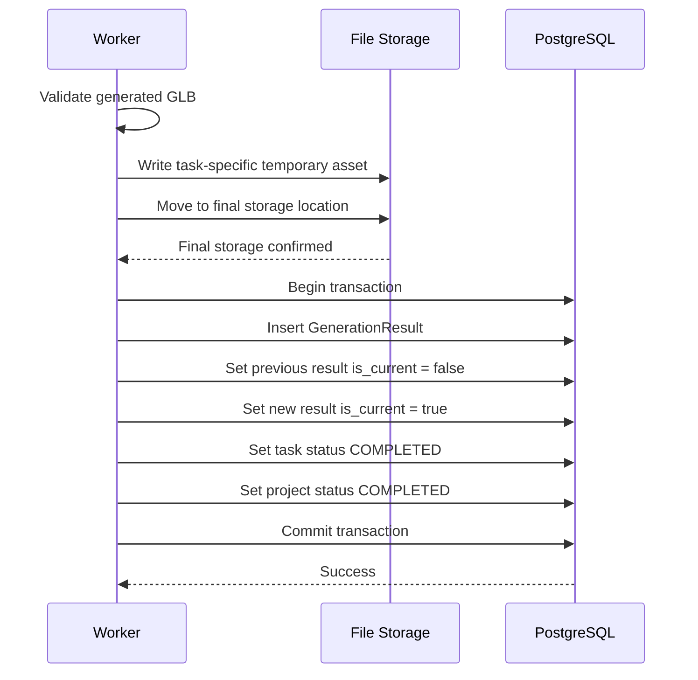

### 10.3. Atomic Database Registration

The following operations must be transactional:

1. Insert new GenerationResult.
2. Set previous current result to `is_current = false`.
3. Set new result to `is_current = true`.
4. Set task status to COMPLETED.
5. Set project status to COMPLETED.
6. Set task completion timestamp.

If the transaction fails, the previous result must remain current.

### 10.4. Filesystem Failure

If the generated file cannot be stored:

- Do not register a successful result.
- Mark the task as FAILED when possible.
- Record STORAGE_WRITE_FAILED.
- Preserve relevant diagnostic information.

If the file is stored but PostgreSQL registration fails:

- Do not report successful generation to the user.
- Leave the previous result unchanged.
- Retry safe database persistence when appropriate.
- Otherwise schedule the unregistered asset for cleanup.

### 10.5. Historical Results

Keep previous result records.

A new successful result becomes current only after it has been validated and successfully registered.

A failed task must not remove the previous current result.

---

## 11. Task Status Data Flow

### 11.1. Worker Updates

Workers must persist:

- Task status.
- Processing stage.
- Progress percentage when available.
- Status message.
- Start timestamp.
- Heartbeat timestamp.
- Completion timestamp.
- Error information when applicable.

### 11.2. Database Update Flow

```text
Worker
  |
  v
Task Status Service
  |
  v
PostgreSQL
  |
  v
GET /projects/{id}/status
  |
  v
FastAPI
  |
  v
Frontend Polling
  |
  v
UI Update
```

### 11.3. Status Polling

The frontend polls the status endpoint while the project has a PENDING or PROCESSING task.

Recommended initial polling interval:

```text
3000 milliseconds
```

Polling must stop when the task reaches:

- COMPLETED.
- FAILED.

The frontend must not create another generation task when a status request fails.

### 11.4. Previous Result Availability

While a new task is running:

- Project status is PENDING or PROCESSING.
- The previous current result remains available.
- `result_available` remains true when a previous successful result exists.

After a failed regeneration:

- Project status is FAILED.
- The failed task is recorded.
- The previous current result remains available.

---

## 12. Failure and Recovery Data Flows

### 12.1. Redis Unavailable During Task Dispatch

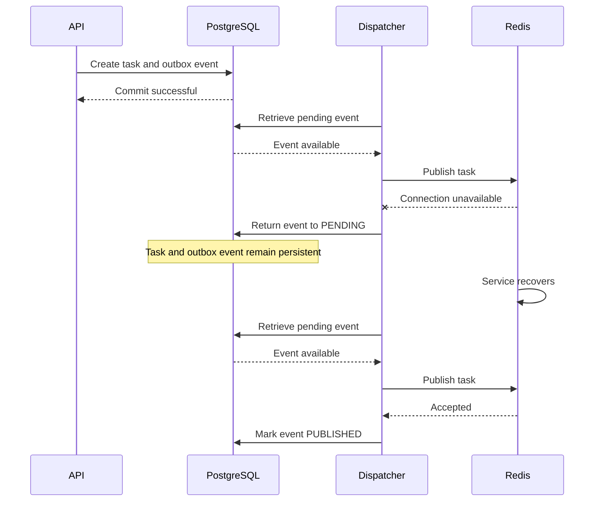

A Redis failure must not permanently lose a committed generation request.

### 12.2. Duplicate Message Delivery

Possible scenario:

1. Dispatcher publishes a Celery message.
2. Redis accepts the message.
3. Dispatcher terminates before marking the outbox event as PUBLISHED.
4. Dispatcher restarts.
5. The message is published again.
6. Worker receives duplicate deliveries.

Required behavior:

- Task status is checked in PostgreSQL.
- Task claiming is atomic.
- Only one worker can claim a pending generation task.
- Duplicate deliveries must not execute conflicting generation pipelines.
- A worker must not register multiple results for one generation task.

### 12.3. Worker Interruption

If a worker stops unexpectedly:

1. The task may remain PROCESSING.
2. Heartbeat information and lease expiration identify the stale task.
3. Recovery logic checks whether the previous worker is still active.
4. Processing artifacts are inspected.
5. The task is resumed or requeued only when safe.
6. Otherwise the task is marked FAILED.
7. The project state is updated.
8. Previous successful results remain available.

A task must not be marked COMPLETED based only on the presence of an output file.

The output must pass the complete validation process.

### 12.4. GPU Out-of-Memory Error

Object Worker failure flow:

1. TripoSR raises a CUDA out-of-memory error.
2. Worker captures the exception.
3. Worker releases temporary GPU resources.
4. Worker records GPU_OUT_OF_MEMORY.
5. Task status becomes FAILED when the failure is confirmed.
6. The user receives an appropriate error.
7. Retry may be offered after configuration or resource adjustment.

Automatic repeated retries with identical GPU settings must be avoided.

### 12.5. COLMAP Reconstruction Failure

1. COLMAP execution terminates unsuccessfully or produces an unusable sparse model.
2. Worker records the current stage.
3. Worker captures logs.
4. Reconstruction diagnostics are collected.
5. OpenMVS processing is not started.
6. GenerationTask becomes FAILED.
7. Previous successful results are preserved.

### 12.6. OpenMVS Processing Failure

1. An OpenMVS processing stage fails.
2. Worker records the stage and error.
3. Subsequent dependent stages are skipped.
4. Diagnostic files are preserved according to retention rules.
5. The task is marked FAILED.
6. The previous current result remains available.

### 12.7. Database Failure During Result Registration

1. Worker validates the GLB.
2. Worker stores the final asset.
3. Database connection fails.
4. Result registration transaction does not complete.
5. Previous current result remains unchanged.
6. Task is not reported as COMPLETED.
7. Recovery logic retries persistence or schedules orphaned asset cleanup.

### 12.8. Worker Heartbeats

Workers must periodically update `heartbeat_at` during long-running processing.

The backend recovery mechanism must use configurable stale-task thresholds.

Do not interpret a single missed heartbeat as proof of worker termination.

The recovery mechanism must account for long-running native subprocesses and temporary infrastructure interruptions.

### 12.9. Task Cancellation During Project Deletion

Task cancellation must be cooperative.

A worker must periodically check whether its project has been deleted or cancellation has been requested.

A `PROCESSING` task may be marked `CANCELLED` only after the corresponding worker execution has stopped.

Cleanup must wait until all workers have stopped using project files.

---

## 13. GLB Download Data Flow

### 13.1. Download Sequence

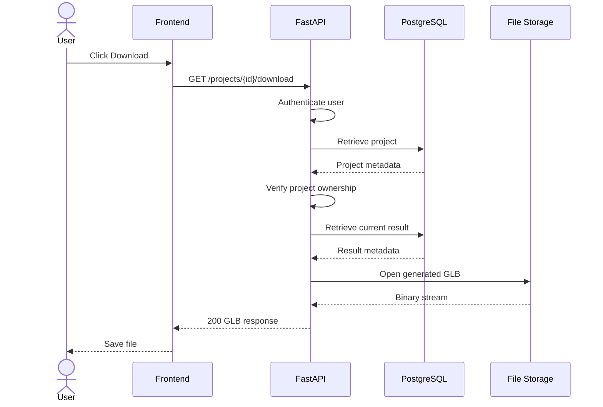

### 13.2. Access Validation

Before returning the file:

1. Validate session.
2. Verify project ownership.
3. Verify current result availability.
4. Verify asset existence.
5. Validate storage reference.
6. Stream the file.

### 13.3. File Delivery

Do not expose the actual storage path.

Do not create permanent public URLs for private models.

Use authorized HTTP downloads.

The download must return the exact generated asset referenced by the current GenerationResult.

---

## 14. Project Deletion Data Flow

### 14.1. General Requirements

Project deletion must be safe even when files are stored outside PostgreSQL.

Use soft deletion followed by asynchronous physical cleanup.

### 14.2. Deletion Sequence

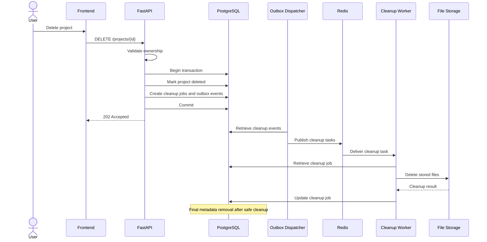

### 14.3. Deletion Rules

When a project is deleted:

- Set `deleted_at`; deletion is logical at this step, not physical.
- Hide the project from ordinary API retrieval.
- Reject new project operations.
- Prevent new uploads and generation.
- Move `PENDING` generation tasks to `CANCELLED`.
- Set `cancel_requested_at` on `PROCESSING` generation tasks.
- Create a cleanup job for the project root directory `projects/{project_id}/` with `target_type = DIRECTORY` and `status = PENDING`.
- Identify associated source images.
- Identify generated assets.
- Identify intermediate directories.
- Wait until active workers have stopped using project files.
- Delete files asynchronously.
- Remove database metadata only after successful cleanup.

Physical deletion order is defined in `05_database_specification.md`: `generation_task_images`, `generation_results`, `generation_tasks`, `project_images`, then `projects`.

`storage_cleanup_jobs` records must be preserved after physical project removal; their `project_id` becomes `NULL`.

Cleanup jobs must remain available even if the project record is physically removed.

### 14.4. Active Worker Coordination

If generation is active:

- Mark the project as deleted.
- Prevent new worker operations from starting.
- Signal cancellation where supported.
- Let the worker stop at a safe processing boundary.
- Do not delete source files still being used.
- Start dependent cleanup only after resource usage has stopped.

The worker must check project deletion or task cancellation state before executing further processing stages.

Cancellation support may initially be internal rather than user-facing.

### 14.5. Cleanup Failure

If file deletion fails:

- Keep the cleanup job persistent.
- Record the error.
- Schedule another attempt.
- Do not mark cleanup as successful.
- Do not silently remove the remaining file references.

### 14.6. Idempotent Cleanup

Deleting a file that no longer exists should count as successful cleanup.

Repeated cleanup operations must not corrupt unrelated project files.

---

## 15. Storage Organization and Data Ownership

### 15.1. Storage Key Convention

Use unique storage keys.

Example:

```text
projects/{project_id}/source/{image_id}.jpg

projects/{project_id}/working/object/{task_id}/

projects/{project_id}/working/scene/{task_id}/

projects/{project_id}/results/{task_id}/model.glb

projects/{project_id}/results/{task_id}/scene.glb
```

### 15.2. Original Images

Original uploaded photographs must remain immutable during project processing.

### 15.3. Working Directories

Each task must use a separate working directory.

Do not reuse the same processing directory for different tasks.

### 15.4. Final Results

Final assets must be stored separately from temporary outputs.

A final asset must be validated before it is registered as a GenerationResult.

### 15.5. Shared Storage

API and workers must use consistent storage key resolution.

In a distributed deployment, replace shared local volumes with a network-accessible storage system or an explicit file transfer mechanism.

---

## 16. Data Flow Security

### 16.1. User Isolation

All project access must use the authenticated user identity.

A worker task identifier must not grant a user access to project resources through the API.

### 16.2. File Access

Internal storage keys must never be treated as publicly accessible URLs.

All external file access must be authorized.

### 16.3. Message Payloads

Celery messages must contain:

- Task identifier.
- Project identifier.
- Task type.
- Required routing metadata.

They must not contain:

- Passwords.
- Session tokens.
- CSRF tokens.
- Large image binaries.
- Full filesystem paths supplied by users.

### 16.4. Worker Access

Workers must retrieve source image references from PostgreSQL and resolve them through the storage abstraction.

Do not trust storage paths received directly from the frontend.

### 16.5. Logging

Do not log:

- Passwords.
- Authentication tokens.
- CSRF tokens.
- Full sensitive user content.

Use request IDs, project IDs and task IDs for diagnostics.

---

## 17. Data Flow Consistency Rules

The following rules are mandatory.

### Rule 1. Database Authority

PostgreSQL is authoritative for project, task and result states.

### Rule 2. Immutable Generation Input

Every generation task must use an explicit immutable image snapshot.

### Rule 3. Atomic Task Creation

GenerationTask, GenerationTaskImage references, project status and OutboxMessage must be created within one database transaction.

### Rule 4. At-Least-Once Delivery

The Outbox Dispatcher may publish a task more than once.

Workers must handle duplicate delivery.

### Rule 5. Atomic Worker Claiming

Only one worker may successfully claim a PENDING task at a time.

### Rule 6. Validated Results

Only validated final GLB assets may become GenerationResults.

### Rule 7. Result Preservation

A previous successful result remains current until a new result has been successfully registered.

### Rule 8. Status Consistency

Task completion and project status updates must be performed consistently.

### Rule 9. Storage Safety

Files must not be deleted while active workers are using them.

### Rule 10. Recoverable Cleanup

File cleanup must be tracked independently and support repeated execution.

### Rule 11. Authorized File Access

Image and GLB retrieval must verify project ownership.

### Rule 12. No Artificial Progress

Processing stages and progress values must come from actual worker execution information.

---

## 18. Related Specifications

- `00_project_overview.md`
- `01_product_requirements.md`
- `02_ui_ux_specification.md`
- `03_frontend_specification.md`
- `04_backend_specification.md`
- `05_database_specification.md`
- `06_object_generation.md`
- `07_scene_reconstruction.md`
- `08_infrastructure.md`
- `09_testing.md`
- `10_development_roadmap.md`
- `architecture/system_architecture.md`
- `architecture/api_contracts.md`
- `AI_DEVELOPMENT_GUIDE.md` — development workflow and agent rules.

All application data flows must follow the interaction sequences and consistency rules defined in this document.