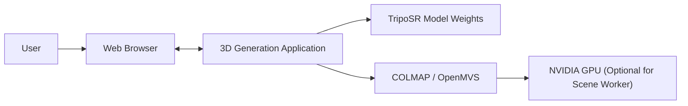
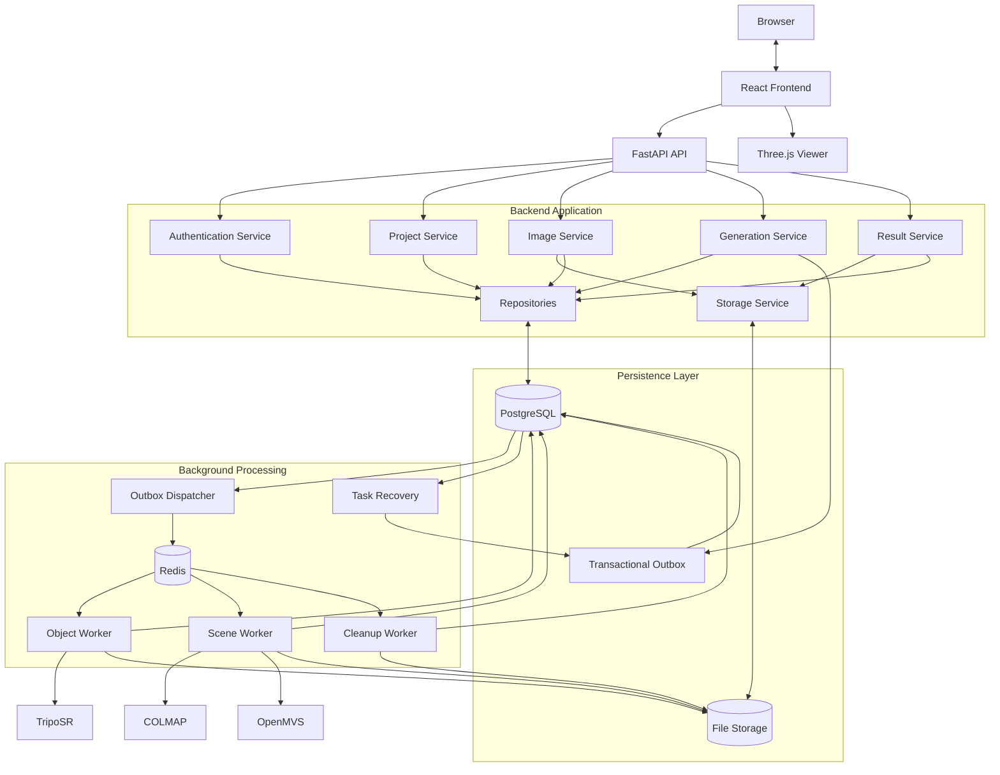
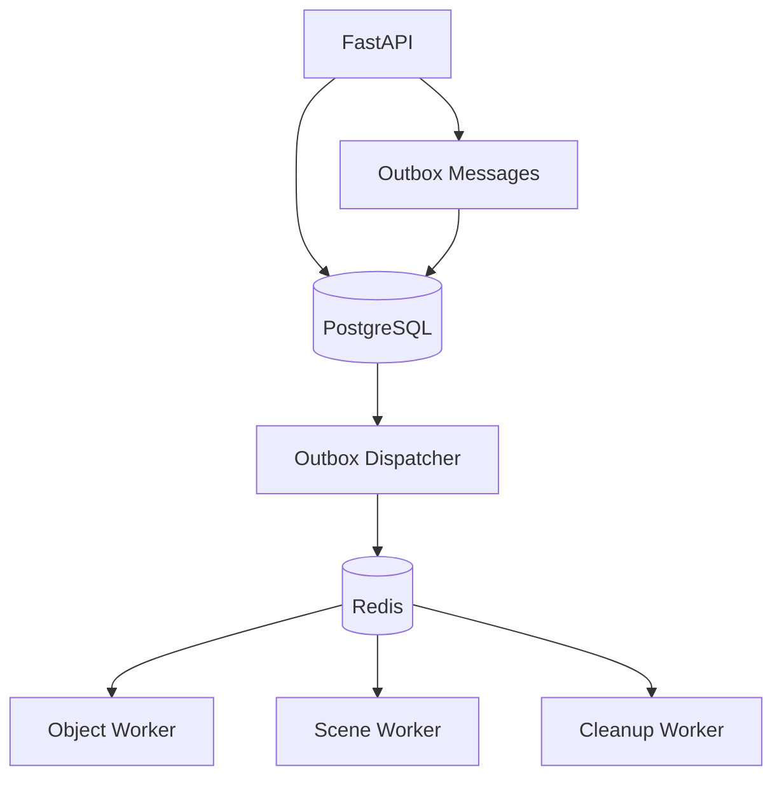

# System Architecture

## 1. Document Purpose

This document describes the overall system architecture of the 3D generation web application.

It defines:

- System boundaries.
- Architectural style.
- Main application components.
- Component responsibilities.
- Communication patterns.
- Deployment architecture.
- Data ownership.
- Security boundaries.
- Architectural decisions.
- Integration principles.
- Scalability requirements.

This document is the central architectural reference for the project.

All subsystem specifications must remain consistent with the architecture defined here.

## 2. System Overview

### 2.1. System Description

The application is a client-server web service that generates individual 3D objects and reconstructs complete 3D environments from photographs.

The application supports two independent processing workflows:

**Object Generation**

Input: one photograph.

Processing: TripoSR.

Output: an individual 3D model in GLB format.

**Scene Reconstruction**

Input: multiple photographs of the same physical environment.

Processing: COLMAP + OpenMVS.

Output: a textured 3D scene in GLB format.

Users interact with the application through a web interface.

The backend manages application logic, data persistence, file storage and background task execution.

ML workers perform computationally intensive operations independently of the API server.

### 2.2. System Goals

The architecture must provide:

- Independent frontend and backend development.
- Separation of business logic and ML processing.
- Asynchronous execution of long-running operations.
- Reliable task delivery.
- Persistent storage of user data and generated assets.
- Secure access to user projects.
- Independent deployment of processing workers.
- Extensibility for future ML algorithms.
- Support for local Docker Compose deployment.
- Possibility of moving ML workers to separate machines.

### 2.3. Architecture Style

Use a modular client-server architecture with asynchronous background processing.

The system combines:

- Layered backend architecture.
- Feature-oriented frontend architecture.
- Relational database persistence.
- Message-driven background processing.
- Independent ML processing modules.
- Shared persistent file storage.

Do not introduce a large microservices architecture for the MVP.

The application should remain a modular system with independently deployable processing workers.

## 3. System Context

### 3.1. External Actors

**Guest User**

Can access the landing page, registration and login.

**Authenticated User**

Can create projects, upload photographs, initiate generation, view results and download generated assets.

**Administrator**

Administrative functionality is outside the MVP scope.

### 3.2. External Dependencies

The system uses:

- TripoSR pretrained model weights.
- COLMAP.
- OpenMVS.
- NVIDIA CUDA where supported.
- External package repositories during controlled dependency installation.
- External model repositories during initial model provisioning.

External services must not be required for every ordinary generation request once dependencies and model weights have been installed.

### 3.3. System Context Diagram



The browser interacts only with the application's public interface.

ML dependencies are internal processing components and are not directly accessible to users.

## 4. Logical System Architecture

### 4.1. Main Components

The system consists of the following logical components:

| Component | Technology | Responsibility |
|---|---|---|
| Frontend | React + TypeScript | User interface |
| 3D Viewer | Three.js | 3D visualization |
| API | FastAPI | HTTP interface and business operations |
| Authentication | FastAPI services | User sessions and access control |
| Project Management | Backend services | Project lifecycle |
| File Management | Storage abstraction | Image and asset storage |
| Database | PostgreSQL | Persistent metadata |
| Message Broker | Redis | Background task delivery |
| Task Dispatcher | Celery + Outbox Dispatcher | Task scheduling |
| Outbox Dispatcher | Python service | Publishes committed outbox events to Redis |
| Task Recovery Service | Python service | Recovers tasks whose worker lease expired |
| Object Worker | Python + PyTorch | TripoSR processing |
| Scene Worker | COLMAP + OpenMVS | Photogrammetric reconstruction |
| Cleanup Worker | Python + Celery | File cleanup |

### 4.2. Component Architecture



## 5. Frontend Architecture

### 5.1. Responsibilities

The frontend is responsible for:

- Rendering the user interface.
- User authentication interactions.
- Project management interfaces.
- Photograph uploading.
- Upload validation for user experience.
- Generation initiation.
- Background task status visualization.
- Result metadata visualization.
- GLB downloading.
- 3D model and scene rendering.

### 5.2. Technologies

- React.
- TypeScript.
- Vite.
- Tailwind CSS.
- React Router.
- TanStack Query.
- Axios.
- React Hook Form.
- Zod.
- Three.js.
- React Three Fiber.

### 5.3. Architectural Constraints

The frontend must not:

- Connect directly to PostgreSQL.
- Connect directly to Redis.
- Access worker processes.
- Execute ML inference.
- Access server filesystem paths.
- Store generated user assets permanently in browser storage.

All application operations must use the backend REST API.

## 6. Backend Architecture

### 6.1. Responsibilities

FastAPI is the central application interface.

It is responsible for:

- Authentication.
- Authorization.
- Request validation.
- Project management.
- Image management.
- Generation task creation.
- Task status retrieval.
- File access.
- Result registration.
- Download authorization.
- Application-level error handling.

### 6.2. Layered Architecture

Use the following dependency direction:

```text
API Layer
   |
   v
Service Layer
   |
   +----------------+
   |                |
   v                v
Repository Layer  Storage Layer
   |
   v
PostgreSQL
```

API handlers must not contain complex business logic.

Services must not directly depend on HTTP request objects.

Repositories must encapsulate database access.

ML workers must remain separate execution components.

### 6.3. API Server Isolation

The API container must not initialize:

- PyTorch models.
- TripoSR.
- COLMAP.
- OpenMVS.

This prevents model initialization and native processing dependencies from affecting ordinary application requests.

## 7. Database Architecture

### 7.1. Responsibilities

PostgreSQL stores all persistent application metadata.

Primary entities:

- users
- user_sessions
- projects
- project_images
- generation_tasks
- generation_task_images
- generation_results
- storage_cleanup_jobs
- outbox_messages

### 7.2. Data Ownership

The database is the authoritative source for:

- User accounts.
- Project information.
- Authentication session metadata.
- Uploaded image metadata.
- Generation task states.
- Generation history.
- Generation result metadata.
- Cleanup state.
- Undelivered background task messages.

### 7.3. Database Transactions

Operations affecting multiple entities must use database transactions.

Critical operations include:

- Project creation.
- Generation task creation.
- Source image snapshot creation.
- Outbox message creation.
- Result registration.
- Result replacement.
- Project soft deletion.

## 8. File Storage Architecture

### 8.1. Responsibilities

The file storage system stores:

- Original photographs.
- Preprocessed photographs.
- Temporary ML processing artifacts.
- Intermediate COLMAP reconstruction data.
- Intermediate OpenMVS files.
- Generated GLB models and scenes.

### 8.2. MVP Implementation

Use local persistent storage mounted through Docker Volumes.

The storage root must be consistent across all services.

Recommended storage layout:

```text
/data/
│
├── projects/
│   └── {project_id}/
│       ├── source/
│       ├── working/
│       │   ├── object/
│       │   └── scene/
│       └── results/
│
└── temporary/
```

The TripoSR model cache is a separate volume mounted only into the Object Worker. It is not part of the application file storage layout.

### 8.3. Storage Abstraction

All file operations must go through a storage abstraction.

Business services must use storage keys rather than operating system paths.

Future migration to S3-compatible storage must not require rewriting project management logic.

### 8.4. File Access

Files must not be publicly accessible by default.

File retrieval must be authorized through the backend.

## 9. Background Processing Architecture

### 9.1. Responsibilities

Long-running generation operations must execute asynchronously.

Use Celery with Redis as the message broker.

### 9.2. Queues

Define three independent queues:

| Queue | Worker |
|---|---|
| object_generation | Object Worker |
| scene_reconstruction | Scene Worker |
| file_cleanup | Cleanup Worker |

### 9.3. Transactional Outbox

The backend must use the Transactional Outbox pattern for reliable generation task dispatch.

Generation task creation and corresponding outbox message creation must be committed in one PostgreSQL transaction.

The API writes generation events into PostgreSQL through the Transactional Outbox pattern.

The Outbox Dispatcher publishes messages to Redis.

Workers use atomic database claiming and persistent leases to prevent conflicting execution.

A separate Task Recovery service handles expired worker leases.

Redis message delivery is treated as at-least-once.

Workers must implement idempotent task execution.

### 9.4. Queue Architecture



### 9.5. Source of Truth

PostgreSQL is the source of truth for task states.

Redis is responsible for message transport.

Celery task execution metadata must not replace persistent GenerationTask records.

## 10. Object Generation Architecture

### 10.1. Processing Component

Use a dedicated Object Worker.

### 10.2. Technology

- Python.
- PyTorch.
- TripoSR.
- CUDA when available.
- Pillow.
- rembg.
- Mesh processing tools.
- GLB export tools.

### 10.3. Processing Workflow

```text
Source Image
    |
    v
Image Preprocessing
    |
    v
TripoSR Inference
    |
    v
Mesh Extraction
    |
    v
Mesh Validation
    |
    v
GLB Export
    |
    v
Asset Validation
    |
    v
Result Storage
```

### 10.4. Resource Isolation

The Object Worker must have its own dependency environment.

The model should be initialized once per worker process and reused between tasks.

Worker concurrency must be configurable and limited according to available GPU memory.

## 11. Scene Reconstruction Architecture

### 11.1. Processing Component

Use a dedicated Scene Worker.

### 11.2. Technology

- Python.
- COLMAP.
- OpenMVS.
- CUDA where supported.
- Native image processing libraries.

### 11.3. Processing Workflow

```text
Multiple Photographs
    |
    v
Input Validation
    |
    v
COLMAP Feature Extraction
    |
    v
COLMAP Feature Matching
    |
    v
Sparse Reconstruction
    |
    v
Camera Validation
    |
    v
Image Undistortion
    |
    v
OpenMVS Import
    |
    v
Dense Reconstruction
    |
    v
Mesh Generation
    |
    v
Mesh Refinement
    |
    v
Texture Generation
    |
    v
GLB Export
    |
    v
Asset Validation
    |
    v
Result Storage
```

### 11.4. Resource Isolation

The Scene Worker must use an independent Docker image.

CPU and GPU usage must be configurable.

The Scene Worker must not block Object Worker execution through unrestricted resource consumption.

## 12. Result Management Architecture

### 12.1. Result Model

Every successfully completed generation task may produce one GenerationResult.

A project may contain multiple historical results.

Only one result may be marked as current.

### 12.2. Result Replacement

When a new generation succeeds:

1. Validate the generated asset.
2. Store the new asset.
3. Register the new GenerationResult.
4. Mark the previous current result as historical.
5. Mark the new result as current.
6. Update project and task status.

These database changes must be transactional.

### 12.3. Failure Behavior

If regeneration fails:

- Preserve previous successful results.
- Keep the previous current result.
- Mark the latest task as FAILED.
- Set the project status to FAILED.
- Make failure information available through the API.

The availability of a current result is independent of the latest task status.

## 13. Project and Task State Architecture

### 13.1. Project Statuses

```text
CREATED
UPLOADING
PENDING
PROCESSING
COMPLETED
FAILED
```

### 13.2. Task Statuses

```text
PENDING
PROCESSING
COMPLETED
FAILED
CANCELLED
```

`CANCELLED` is an internal terminal state.

Project status describes the latest project generation lifecycle.

Current result availability is maintained independently.

### 13.3. Status Ownership

A GenerationTask records the state of one execution attempt.

A Project status represents the latest project generation attempt or current upload lifecycle.

The current result reference is independent of the project status.

### 13.4. State Consistency

Status changes must be performed by backend services and workers through persistent database updates.

The frontend must not modify project or task states independently.

## 14. Communication Architecture

### 14.1. Frontend to Backend

Protocol: HTTP/HTTPS.

Format: JSON and multipart/form-data.

Authentication: secure cookie-based sessions.

### 14.2. Backend to Database

Protocol: PostgreSQL connection.

Technology: SQLAlchemy.

### 14.3. Outbox Dispatcher to Redis

Protocol: Redis connection.

Purpose: background task dispatch.

The API must not publish generation messages directly to Redis. Only the Outbox Dispatcher performs this operation.

### 14.4. Dispatcher to Workers

Protocol: Celery message delivery through Redis.

### 14.5. Workers to Database

Workers use separate SQLAlchemy sessions and persistent task records.

### 14.6. Workers to Storage

Workers access shared storage through the storage abstraction or a dedicated worker storage adapter using the same storage keys.

### 14.7. Status Updates

The frontend retrieves processing information through REST API polling.

WebSockets are outside the MVP scope.

## 15. Security Boundaries

### 15.1. External Boundary

The browser can access only the public frontend and authorized backend endpoints.

### 15.2. Application Boundary

FastAPI is the only public application API.

### 15.3. Infrastructure Boundary

PostgreSQL, Redis and workers must remain internal services.

### 15.4. Storage Boundary

User files must not be exposed as public static directories.

### 15.5. Worker Boundary

Workers must access only the resources required for their assigned tasks.

### 15.6. User Isolation

Every project, image, generation task and result operation must be authorized using the authenticated user and project ownership.

## 16. Deployment Architecture

### 16.1. MVP Deployment

Use one Docker Compose environment containing:

- frontend
- api
- db
- redis
- migration
- outbox-dispatcher
- task-recovery
- object-worker
- scene-worker
- cleanup-worker

### 16.2. GPU Configuration

GPU access is optional at the system level.

Object Worker should use NVIDIA GPU acceleration where available.

Scene Worker can execute on CPU or use compatible GPU acceleration.

The API and database must not require GPU access.

### 16.3. Future Deployment

The architecture should support moving workers to a separate GPU server.

Future infrastructure may include:

- Separate API server.
- Separate GPU processing servers.
- S3-compatible storage.
- Managed PostgreSQL.
- Managed Redis.
- Distributed worker orchestration.

These changes are outside the MVP scope.

## 17. Architectural Decisions

| ID | Decision | Rationale |
|---|---|---|
| ADR-001 | Modular client-server architecture | Simplicity and maintainability |
| ADR-002 | FastAPI backend | Python ML ecosystem integration |
| ADR-003 | React + TypeScript frontend | Typed UI development |
| ADR-004 | PostgreSQL | Persistent relational metadata |
| ADR-005 | Redis + Celery | Asynchronous processing |
| ADR-006 | Transactional Outbox | Reliable task dispatch |
| ADR-007 | Separate ML workers | Dependency and resource isolation |
| ADR-008 | TripoSR for objects | Single-image object reconstruction |
| ADR-009 | COLMAP + OpenMVS for scenes | Photogrammetric reconstruction |
| ADR-010 | GLB as primary output | Browser-compatible asset format |
| ADR-011 | Local persistent storage for MVP | Simple initial deployment |
| ADR-012 | Cookie-based session authentication | Server-controlled session management |
| ADR-013 | Three.js viewer | Browser-based 3D visualization |
| ADR-014 | Docker Compose | Unified local deployment |
| ADR-015 | Session-bound signed double-submit CSRF | Consistent cookie-based CSRF validation |
| ADR-016 | Persistent worker leases | Detect interrupted tasks |
| ADR-017 | Separate Task Recovery service | Reliable task recovery |
| ADR-018 | Composite project ownership constraints | Database-level referential integrity |

## 18. Architecture Constraints

- Do not execute ML inference inside HTTP handlers.
- Do not connect frontend directly to databases or message brokers.
- Do not store large binary assets in PostgreSQL.
- Do not expose internal filesystem paths.
- Do not rely on Redis as the only task state store.
- Do not allow multiple active generation tasks for the same project.
- Do not overwrite previous successful results before validating new results.
- Do not implement fake ML processing.
- Do not combine Object and Scene worker dependencies into one mandatory runtime image.
- Do not add Kubernetes to the MVP.

## 19. Related Documentation

- `00_project_overview.md`
- `01_product_requirements.md`
- `02_ui_ux_specification.md`
- `03_frontend_specification.md`
- `04_backend_specification.md`
- `05_database_specification.md`
- `06_object_generation.md`
- `07_scene_reconstruction.md`
- `08_infrastructure.md`
- `09_testing.md`
- `10_development_roadmap.md`
- `architecture/api_contracts.md`
- `architecture/data_flow.md`
- `AI_DEVELOPMENT_GUIDE.md` — development workflow and agent rules.