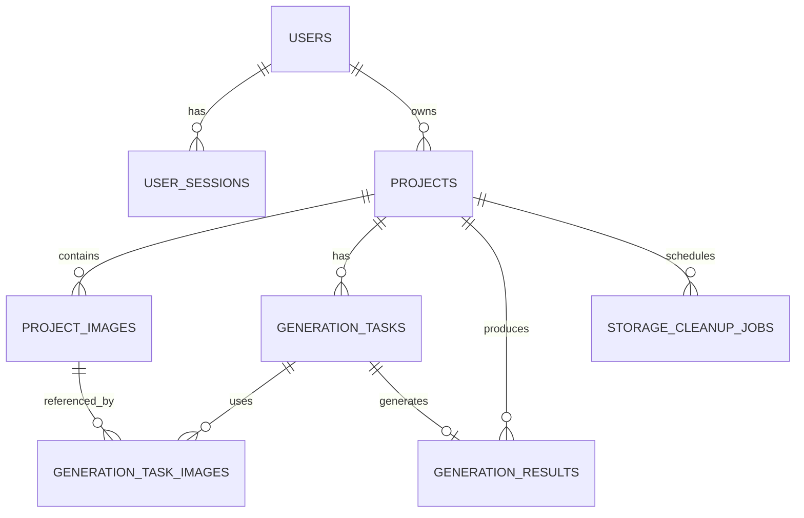

# 05 — Database Specification

## 1. Document Purpose

This document defines the database architecture and data model for the 3D generation web application.

It describes:
- Database technology and configuration.
- Database design principles.
- Entity relationships.
- Table structures.
- Data types and constraints.
- Indexes and uniqueness rules.
- Project and generation task lifecycle.
- File metadata management.
- Transaction management.
- Data deletion and retention.
- Database migrations.
- Testing requirements.

The database must support all functionality defined in:

- `00_project_overview.md`
- `01_product_requirements.md`
- `04_backend_specification.md`

This document defines the canonical persistent data model.

All backend repositories, ORM models and database migrations must follow this specification.

---

## 2. Database Technology

### 2.1. Primary Database

Use PostgreSQL as the primary relational database.

Recommended technologies:

| Component | Technology |
|---|---|
| Database | PostgreSQL |
| ORM | SQLAlchemy 2.x |
| Migrations | Alembic |
| Python Driver | psycopg |
| Data Validation | Pydantic |
| Database Schema | Relational |
| Flexible Metadata | JSONB |

### 2.2. Database Responsibilities

PostgreSQL must store:

- User accounts.
- Authentication sessions.
- Project metadata.
- Source image metadata.
- Generation task information.
- Generation task input references.
- Generated result metadata.
- File cleanup task information.
- Durable outbox events for reliable background dispatch.

Large binary files must not be stored directly in PostgreSQL.

Source photographs, generated meshes and intermediate processing artifacts must be stored in the configured file storage.

The database stores references to these files.

### 2.3. Development Environment

The database must run as an independent Docker Compose service.

Use persistent Docker Volumes to preserve database files across container restarts.

Database configuration must be environment-driven.

Do not hardcode database credentials in application source code.

---

## 3. Database Design Principles

The database must follow the following principles.

### 3.1. Relational Data Model

Use normalized relational tables for core entities.

Each table must represent one clearly defined domain entity.

Avoid storing related entities as serialized JSON when relational structures are more appropriate.

### 3.2. Primary Keys

Use UUID as the primary key type for all major entities.

UUIDs must be generated by the application or through an appropriate database default.

Recommended Python implementation:

`uuid.uuid4()`

UUID identifiers must be used for:

- Users.
- Sessions.
- Projects.
- Uploaded images.
- Generation tasks.
- Generation results.
- Cleanup tasks.
- Outbox events.

This makes entity identifiers difficult to enumerate and facilitates distributed processing.

UUIDs do not replace authorization checks.

### 3.3. Timestamps

All timestamps must be stored using PostgreSQL `TIMESTAMPTZ`.

Store and process timestamps in UTC.

Use the following common fields where appropriate:

- `created_at`
- `updated_at`

Additional timestamps must be provided for lifecycle events:

- `started_at`
- `completed_at`
- `expires_at`
- `deleted_at`

### 3.4. Naming Conventions

Use:

- snake_case for table names.
- snake_case for column names.
- UUID for entity identifiers.
- Singular or plural table naming consistently; use plural table names throughout this project.
- Explicit foreign key names.
- Explicit index names.

Examples:

- `users`
- `projects`
- `project_images`
- `generation_tasks`
- `generation_results`

### 3.5. Referential Integrity

Use foreign keys to maintain relationships between entities.

Define explicit deletion behavior for every relationship.

Use cascading deletion only when it is consistent with the entity lifecycle.

Do not allow database records to reference nonexistent projects, users or generation tasks.

### 3.6. Enumerated Values

Use string-based status and type columns with PostgreSQL CHECK constraints for the MVP.

This approach simplifies future status changes and Alembic migrations compared with tightly coupled native PostgreSQL ENUM types.

### 3.7. Flexible Metadata

Use JSONB only for supplementary metadata that may vary between generation algorithms.

Do not use JSONB to replace relational columns for frequently queried information such as:

- User identifiers.
- Project types.
- Project statuses.
- Task statuses.
- Result identifiers.
- File sizes.

---

## 4. Entity Overview

The application database must contain the following primary entities:

| Entity | Purpose |
|---|---|
| User | User account information |
| UserSession | Authenticated sessions |
| Project | User generation projects |
| ProjectImage | Source image metadata |
| GenerationTask | Individual generation attempts |
| GenerationTaskImage | Snapshot of images used by a generation task |
| GenerationResult | Generated 3D assets |
| StorageCleanupJob | Asynchronous file cleanup operations |
| OutboxMessage | Durable background dispatch events |

Each entity must have a clearly defined responsibility.

### 4.1. Entity Relationship Diagram



A project can have multiple generation tasks because users may retry failed operations or initiate a new generation.

A generation task may produce at most one successfully registered result in the MVP.

A project can retain multiple historical results, but only one result can be marked as current at a time.

`OutboxMessage` is not part of the project ownership graph. It references an aggregate through `aggregate_type` and `aggregate_id`, and intentionally has no foreign key to `projects` or `generation_tasks`.

---

## 5. Table: users

Purpose: store application user accounts.

Table name:

`users`

### 5.1. Columns

| Column | PostgreSQL Type | Constraints | Description |
|---|---|---|---|
| id | UUID | PK | Unique user identifier |
| email | VARCHAR(320) | UNIQUE, NOT NULL | Normalized email |
| password_hash | VARCHAR(255) | NOT NULL | Password hash |
| is_active | BOOLEAN | NOT NULL, DEFAULT TRUE | Account status |
| created_at | TIMESTAMPTZ | NOT NULL | Creation timestamp |
| updated_at | TIMESTAMPTZ | NOT NULL | Last update timestamp |

### 5.2. Constraints

- Email must be normalized to lowercase before insertion.
- Email must be unique.
- Passwords must never be stored in plaintext.
- Password hashes must be generated using Argon2id or an equivalent secure algorithm.
- Inactive users must not be allowed to authenticate.

### 5.3. Relationships

One user can have:

- Multiple authenticated sessions.
- Multiple projects.

A user account must not be deleted while associated projects or files remain without an explicit cleanup process.

### 5.4. Indexes

Create:

- Unique index on `email`.

---

## 6. Table: user_sessions

Purpose: store authenticated user sessions.

Table name:

`user_sessions`

The application uses server-managed session authentication.

The raw session token is stored in an HttpOnly cookie and must never be stored in the database.

Only its cryptographic hash is stored.

### 6.1. Columns

| Column | PostgreSQL Type | Constraints | Description |
|---|---|---|---|
| id | UUID | PK | Session identifier |
| user_id | UUID | FK, NOT NULL | Session owner |
| token_hash | VARCHAR(64) | UNIQUE, NOT NULL | SHA-256 session token hash |
| expires_at | TIMESTAMPTZ | NOT NULL | Session expiration |
| revoked_at | TIMESTAMPTZ | NULL | Revocation timestamp |
| last_used_at | TIMESTAMPTZ | NULL | Last activity |
| created_at | TIMESTAMPTZ | NOT NULL | Creation timestamp |

### 6.2. Constraints

- `token_hash` must be unique.
- Each session must belong to an existing user.
- Expiration must be later than creation.
- Revoked sessions must not be accepted.
- Expired sessions must not be accepted.
- CSRF state must not be stored in the database. The CSRF token is a signed, session-bound double-submit cookie; the backend verifies its signature, the cookie/header match and its binding to the session.

### 6.3. Relationships

Many sessions can belong to one user.

When a user is deleted, associated sessions must be deleted.

Foreign key behavior:

`user_id -> users.id ON DELETE CASCADE`

### 6.4. Indexes

Create:

- Unique index on `token_hash`.
- Index on `user_id`.
- Index on `expires_at`.

### 6.5. Session Cleanup

Expired and revoked sessions should be periodically removed.

Session cleanup must not interfere with active user operations.

---

## 7. Table: projects

Purpose: store user-created generation projects.

Table name:

`projects`

Each project represents one independent generation workflow.

A project must have exactly one generation type.

### 7.1. Columns

| Column | PostgreSQL Type | Constraints | Description |
|---|---|---|---|
| id | UUID | PK | Project identifier |
| user_id | UUID | FK, NOT NULL | Project owner |
| name | VARCHAR(150) | NOT NULL | Project name |
| type | VARCHAR(20) | NOT NULL | Generation type |
| status | VARCHAR(20) | NOT NULL | Current project status |
| created_at | TIMESTAMPTZ | NOT NULL | Creation timestamp |
| updated_at | TIMESTAMPTZ | NOT NULL | Last modification |
| deleted_at | TIMESTAMPTZ | NULL | Soft deletion timestamp |

### 7.2. Project Types

Supported values:

```text
OBJECT
SCENE
```

`OBJECT` represents an individual 3D object generated from one photograph.

`SCENE` represents a reconstructed environment generated from multiple photographs.

### 7.3. Project Statuses

Supported values:

```text
CREATED
UPLOADING
PENDING
PROCESSING
COMPLETED
FAILED
```

Descriptions:

| Status | Description |
|---|---|
| CREATED | Project exists and is ready for configuration or generation |
| UPLOADING | Source images are being uploaded |
| PENDING | Generation task is waiting for processing |
| PROCESSING | Generation is running |
| COMPLETED | Latest generation task completed successfully |
| FAILED | Latest generation task failed |

### 7.4. Constraints

- Every project belongs to exactly one user.
- Project type must be OBJECT or SCENE.
- Project status must be one of the supported values.
- Project name must not be empty.
- Project name must have a configurable maximum length.
- Soft-deleted projects must not appear in ordinary project queries.

### 7.5. Relationships

One project belongs to one user.

One project can contain:

- Multiple source images.
- Multiple generation tasks.
- Multiple historical results.
- Multiple cleanup operations.

### 7.6. Indexes

Create:

- Index on `user_id`.
- Composite index on `(user_id, created_at DESC)`.
- Composite index on `(user_id, status)`.
- Index on `type`.
- Index on `deleted_at`.

Ordinary project retrieval must filter out records where `deleted_at IS NOT NULL`.

### 7.7. Project Lifecycle Rules

The backend must enforce valid project transitions.

Recommended transitions:

```text
CREATED
   |
   v
UPLOADING
   |
   v
CREATED
   |
   v
PENDING
   |
   v
PROCESSING
   |
   +-----------> COMPLETED
   |
   +-----------> FAILED
```

A project in FAILED or COMPLETED may start a new generation task when all required conditions are satisfied.

When a new generation starts, the project returns to PENDING.

A previous successful result must remain available while the new generation is running.

When the new generation succeeds, the new result becomes the current result.

When the new generation fails, the previous successful result remains the current result.

### 7.8. Ownership

Every project operation must verify ownership using `user_id`.

Never rely on UUID identifiers alone for authorization.

---

## 8. Table: project_images

Purpose: store metadata about photographs uploaded to a project.

Table name:

`project_images`

The actual image files are stored in the filesystem.

This table stores only their metadata and storage references.

### 8.1. Columns

| Column | PostgreSQL Type | Constraints | Description |
|---|---|---|---|
| id | UUID | PK | Image identifier |
| project_id | UUID | FK, NOT NULL | Associated project |
| original_filename | VARCHAR(255) | NOT NULL | Original uploaded filename |
| storage_key | VARCHAR(512) | UNIQUE, NOT NULL | Internal storage reference |
| mime_type | VARCHAR(100) | NOT NULL | Verified MIME type |
| file_size_bytes | BIGINT | NOT NULL | File size |
| sha256 | VARCHAR(64) | NOT NULL | Content checksum |
| width | INTEGER | NOT NULL | Image width |
| height | INTEGER | NOT NULL | Image height |
| position | INTEGER | NOT NULL | Image order |
| created_at | TIMESTAMPTZ | NOT NULL | Upload timestamp |

### 8.2. Supported MIME Types

The MVP supports:

```text
image/jpeg
image/png
```

The actual image format must be validated by the backend.

The database values must represent the verified format rather than blindly trusting the client's MIME declaration.

### 8.3. Constraints

- Every image must belong to an existing project.
- File size must be greater than zero.
- Image dimensions must be positive.
- Position must be non-negative.
- Storage key must be unique.
- SHA-256 must contain a valid checksum representation.
- Composite uniqueness on `(id, project_id)` must be enforced. It allows other tables to verify that a referenced image belongs to the same project as the referencing record.

### 8.4. Image Count Restrictions

The following application-level rules must be enforced:

For OBJECT projects:

- Exactly one source image is allowed.
- An additional image must be rejected unless the existing image can be safely replaced.

For SCENE projects:

- Multiple images are allowed.
- Minimum and maximum counts are configurable.

Initial defaults:

```text
MIN_SCENE_IMAGES=3
MAX_SCENE_IMAGES=100
```

These rules must be validated by the backend service.

A normal SQL CHECK constraint cannot reliably enforce the total number of rows across related image records.

### 8.5. Relationships

One project can contain multiple source images.

Project deletion eventually removes associated image metadata.

An image must not be physically or logically removed while an active generation worker is using it.

Once an image has been referenced by a generation task, its contents and storage reference must remain immutable while that task or its retry workflow depends on it.

### 8.6. Indexes

Create:

- Index on `project_id`.
- Composite index on `(project_id, position)`.
- Unique index on `storage_key`.
- Composite index on `(project_id, sha256)` if duplicate-image detection is enabled.
- Unique constraint on `(id, project_id)` for composite ownership checks.

### 8.7. File Storage Rules

The `storage_key` must be an opaque relative storage reference.

Example:

```text
projects/{project_id}/source/{image_id}.jpg
```

Do not store absolute operating system paths.

Do not expose storage keys directly to unauthorized clients.

The storage service is responsible for resolving keys to physical files safely.

---

## 9. Table: generation_tasks

Purpose: store every generation or reconstruction attempt.

Table name:

`generation_tasks`

A generation task represents one processing attempt.

A project can have multiple tasks throughout its lifetime.

Do not overwrite previous task records when retrying generation.

### 9.1. Columns

| Column | PostgreSQL Type | Constraints | Description |
|---|---|---|---|
| id | UUID | PK | Task identifier |
| project_id | UUID | FK, NOT NULL | Associated project |
| task_type | VARCHAR(20) | NOT NULL | OBJECT or SCENE |
| status | VARCHAR(20) | NOT NULL | Task status |
| celery_task_id | VARCHAR(255) | UNIQUE, NULL | Celery task ID; stores the GenerationTask UUID |
| idempotency_key | VARCHAR(255) | NOT NULL | Client request idempotency key, scoped to the project |
| request_fingerprint | VARCHAR(64) | NOT NULL | Canonical fingerprint of the generation request |
| stage | VARCHAR(50) | NULL | Current processing stage |
| progress_percent | SMALLINT | NULL | Actual reported progress |
| status_message | TEXT | NULL | User-friendly status message |
| error_code | VARCHAR(100) | NULL | Stable error identifier |
| error_message | TEXT | NULL | User-friendly error |
| parameters | JSONB | NOT NULL | Generation configuration snapshot |
| queued_at | TIMESTAMPTZ | NULL | Queue timestamp |
| started_at | TIMESTAMPTZ | NULL | Processing start |
| finished_at | TIMESTAMPTZ | NULL | Processing completion |
| heartbeat_at | TIMESTAMPTZ | NULL | Last worker heartbeat; renewed while the lease is valid |
| attempt_count | INTEGER | NOT NULL, DEFAULT 0 | Internal worker recovery attempts |
| worker_id | VARCHAR(255) | NULL | Identifier of the worker holding the lease |
| lease_expires_at | TIMESTAMPTZ | NULL | Expiration of the current worker lease |
| cancel_requested_at | TIMESTAMPTZ | NULL | Requested cooperative cancellation |
| created_at | TIMESTAMPTZ | NOT NULL | Task creation |
| updated_at | TIMESTAMPTZ | NOT NULL | Last modification |

### 9.2. Task Types

Supported values:

```text
OBJECT
SCENE
```

The task type must correspond to the parent project's generation type.

### 9.3. Task Statuses

Supported values:

```text
PENDING
PROCESSING
COMPLETED
FAILED
CANCELLED
```

Descriptions:

| Status | Description |
|---|---|
| PENDING | Task is waiting in the queue |
| PROCESSING | Worker is executing the task |
| COMPLETED | Generation finished successfully |
| FAILED | Generation terminated unsuccessfully |
| CANCELLED | Internal terminal state: processing was stopped |

Task identity rules:

> A GenerationTask represents one logical generation request.
>
> Internal worker recovery attempts are counted by `attempt_count` and do not create new GenerationTask records.
>
> Manual user retries create new GenerationTask records.
>
> `CANCELLED` is an internal terminal state used when processing must be stopped, primarily during project deletion.

### 9.4. Processing Stage

The `stage` column records the latest known processing stage.

Object generation may use:

```text
IMAGE_PREPARATION
MODEL_GENERATION
MODEL_EXPORT
RESULT_VALIDATION
```

Scene reconstruction may use:

```text
IMAGE_PREPARATION
FEATURE_EXTRACTION
FEATURE_MATCHING
SPARSE_RECONSTRUCTION
RECONSTRUCTION_VALIDATION
IMAGE_UNDISTORTION
OPENMVS_IMPORT
DENSE_RECONSTRUCTION
MESH_GENERATION
MESH_REFINEMENT
TEXTURING
ASSET_EXPORT
RESULT_VALIDATION
```

Stages are informational and may differ between algorithm implementations.

Store only actual stages reported by the worker.

`COMPLETED`, `FAILED` and `CANCELLED` are task states, not processing stages. They must never be written to the `stage` column.

### 9.5. Progress

The `progress_percent` field is optional.

Allowed values:

```text
0-100
```

NULL means that reliable percentage information is unavailable.

Do not generate artificial progress values.

### 9.6. Idempotency

Generation requests must include an `Idempotency-Key`.

The key is scoped to the project.

The same key together with the same request fingerprint returns the existing task.

The same key with a different request fingerprint must be rejected with HTTP 409.

A new user-initiated generation attempt must use a new key.

Internal worker recovery reuses the existing GenerationTask and does not create a new idempotency key.

`request_fingerprint` stores a stable hash (SHA-256, 64 hexadecimal characters) of the canonical generation request: project ID, task type, the ordered source image identifiers and every generation parameter that can affect the result. It lets the backend verify that a repeated request with the same key corresponds to the original operation instead of silently accepting a different operation under a reused key.

The database must enforce uniqueness of `(project_id, idempotency_key)`.

### 9.7. Task Parameters

Store a snapshot of relevant generation parameters in JSONB.

Examples:

Object task:

```json
{
  "algorithm": "TripoSR",
  "output_format": "GLB"
}
```

Scene task:

```json
{
  "algorithm": "COLMAP_OPENMVS",
  "output_format": "GLB"
}
```

The examples describe logical settings rather than mandatory implementation parameters.

Do not store credentials, raw image contents or large binary payloads in this field.

### 9.8. Error Handling

When a task fails:

- Set status to FAILED.
- Store a stable error code.
- Store a user-friendly error message.
- Set `finished_at`.
- Preserve the task record.

Internal exceptions and full stack traces should remain in application or worker logs.

Do not expose internal diagnostic data through ordinary API responses.

### 9.9. Relationships

One project can have multiple generation tasks.

Each task belongs to exactly one project.

A task can reference multiple source images through `generation_task_images`.

A task may produce one generation result.

### 9.10. Indexes

Create:

- Index on `project_id`.
- Composite index on `(project_id, created_at DESC)`.
- Composite index on `(status, created_at)`.
- Composite index on `(status, lease_expires_at)` for expired-lease recovery.
- Index on `worker_id`.
- Unique index on `celery_task_id`.
- Unique constraint on `(id, project_id)` for composite ownership checks.

Idempotency keys are project-scoped and mandatory:

```sql
CREATE UNIQUE INDEX uq_generation_task_idempotency
ON generation_tasks (project_id, idempotency_key);
```

Create a partial unique index that allows no more than one active task per project:

```sql
CREATE UNIQUE INDEX uq_generation_task_active_project
ON generation_tasks (project_id)
WHERE status IN ('PENDING', 'PROCESSING');
```

This index is an additional persistence-level safeguard against concurrent generation.

The lease indexes allow the Task Recovery service to find candidate tasks without scanning the entire table.

### 9.11. Task and Project Consistency

Task status and project status must be updated consistently.

Examples:

| Task Status | Project Status |
|---|---|
| PENDING | PENDING |
| PROCESSING | PROCESSING |
| COMPLETED | COMPLETED |
| FAILED | FAILED |

`CANCELLED` has no corresponding project status. When a task is cancelled because the project is being deleted, the project is hidden by `deleted_at` and no project state transition is required. When cancellation is requested for another internal reason, the project remains in its current state until a new task is started.

A worker may claim a task only through an atomic conditional transition from `PENDING` to `PROCESSING`. The same statement must record `worker_id`, `started_at`, `heartbeat_at` and `lease_expires_at`. A duplicate delivery must not start another processing instance while a valid lease exists. The Task Recovery service may requeue a task only after its lease has expired and the previous worker has been confirmed inactive. Lease expiration and recovery increment `attempt_count`; they never create a new GenerationTask.

The backend service must update both records in the appropriate database transaction.

Do not rely exclusively on frontend state or Redis task status.

---

## 10. Table: generation_task_images

Purpose: record the exact source photographs used by a generation task.

Table name:

`generation_task_images`

This table provides an immutable input snapshot for each generation attempt.

It is important because users may have multiple generation attempts associated with the same project.

### 10.1. Columns

| Column | PostgreSQL Type | Constraints | Description |
|---|---|---|---|
| task_id | UUID | FK, NOT NULL | Generation task |
| image_id | UUID | FK, NOT NULL | Source image |
| project_id | UUID | FK, NOT NULL | Owning project, duplicated for composite integrity |
| position | INTEGER | NOT NULL | Processing order |
| created_at | TIMESTAMPTZ | NOT NULL | Association timestamp |

### 10.2. Primary Key

Use a composite primary key:

```text
(task_id, image_id)
```

### 10.3. Constraints

- A task cannot reference the same source image more than once.
- Position must be non-negative.
- Every referenced task and image must exist.
- The task and the image must belong to the same project:

```sql
FOREIGN KEY (task_id, project_id)
    REFERENCES generation_tasks (id, project_id);

FOREIGN KEY (image_id, project_id)
    REFERENCES project_images (id, project_id);
```

These composite foreign keys rely on the `UNIQUE (id, project_id)` constraints of `generation_tasks` and `project_images`. PostgreSQL then guarantees that a task and an image associated by this row always belong to the same project, so an application error cannot create a cross-project reference.

Use restrictive deletion behavior for image references while generation history needs to remain available.

### 10.4. Purpose

This table ensures:

- The worker knows exactly which images belong to a task.
- Retried tasks can use a separate input snapshot.
- Project image ordering can be preserved.
- Source image modifications cannot silently change an already-started task.

Before starting generation, the backend must create the task and its input references within an appropriate transaction.

The worker must use this snapshot rather than loading an arbitrary current list of project images.

---

## 11. Table: generation_results

Purpose: store metadata about generated 3D assets.

Table name:

`generation_results`

The generated binary file is stored outside PostgreSQL.

This table stores its metadata and storage reference.

### 11.1. Columns

| Column | PostgreSQL Type | Constraints | Description |
|---|---|---|---|
| id | UUID | PK | Result identifier |
| project_id | UUID | FK, NOT NULL | Associated project |
| task_id | UUID | FK, NOT NULL, UNIQUE | Generating task |
| format | VARCHAR(20) | NOT NULL | Asset format |
| mime_type | VARCHAR(100) | NOT NULL | File MIME type |
| storage_key | VARCHAR(512) | UNIQUE, NOT NULL | Internal storage reference |
| file_size_bytes | BIGINT | NOT NULL | Asset size |
| sha256 | VARCHAR(64) | NOT NULL | File checksum |
| metadata | JSONB | NOT NULL | Optional model metadata |
| is_current | BOOLEAN | NOT NULL, DEFAULT FALSE | Current project result |
| created_at | TIMESTAMPTZ | NOT NULL | Result creation |

### 11.2. Supported Formats

The primary MVP format is:

```text
GLB
```

The schema may permit future formats:

```text
GLB
OBJ
STL
```

Only formats with actual export implementations may be exposed through the application.

### 11.3. Constraints

- Every result must belong to an existing project.
- Every result must correspond to a completed generation task.
- The result and its generating task must belong to the same project:

```sql
FOREIGN KEY (task_id, project_id)
    REFERENCES generation_tasks (id, project_id);
```

This composite foreign key relies on `UNIQUE (id, project_id)` in `generation_tasks`. It prevents a result from being attached to a task of another project.

- A generation task may have at most one result.
- File size must be greater than zero.
- Storage key must be unique.
- SHA-256 must represent the generated file checksum.

The backend must verify successful file creation and validation before inserting the result record.

### 11.4. Current Result

A project can contain multiple historical generation results.

Only one result may be marked as current.

Use a partial unique index:

```sql
CREATE UNIQUE INDEX uq_generation_results_current_project
ON generation_results (project_id)
WHERE is_current = TRUE;
```

When a new generation succeeds:

1. Validate the generated asset.
2. Store it in its final location.
3. Begin a database transaction.
4. Mark the previous current result as not current.
5. Insert the new result as current.
6. Update the project status to COMPLETED.
7. Update the task status to COMPLETED.
8. Commit the transaction.

The previous result must remain intact until the new result is successfully validated and registered.

If the new generation fails, the previous result remains current.

### 11.5. Result Metadata

The JSONB metadata field may contain optional technical information:

```json
{
  "vertices_count": 125000,
  "faces_count": 83000,
  "textures_count": 2,
  "bounding_box": {
    "width": 1.2,
    "height": 0.9,
    "depth": 1.1
  }
}
```

This is an illustrative schema.

The actual metadata depends on the algorithm and export pipeline.

Core result fields must remain relational columns rather than being moved into JSONB.

### 11.6. Indexes

Create:

- Index on `project_id`.
- Index on `task_id`.
- Unique index on `storage_key`.
- Unique partial index on `project_id` for current results.

### 11.7. Result Access

The backend must retrieve the current result through the project association.

Clients must not receive direct internal storage paths.

Result downloads must pass project ownership and authorization checks.

---

## 12. Table: storage_cleanup_jobs

Purpose: track asynchronous cleanup of stored files and intermediate directories.

Table name:

`storage_cleanup_jobs`

This table supports reliable deletion of files when projects or obsolete results are removed.

Filesystem operations and PostgreSQL transactions cannot be committed atomically.

Therefore, deleting a database record must not assume that corresponding files have already been removed.

### 12.1. Columns

| Column | PostgreSQL Type | Constraints | Description |
|---|---|---|---|
| id | UUID | PK | Cleanup job identifier |
| project_id | UUID | FK, NULL | Associated project |
| storage_key | VARCHAR(512) | NOT NULL | Storage target |
| target_type | VARCHAR(20) | NOT NULL | FILE or DIRECTORY |
| status | VARCHAR(20) | NOT NULL | Cleanup state |
| attempts | INTEGER | NOT NULL, DEFAULT 0 | Number of attempts |
| last_error | TEXT | NULL | Last cleanup error |
| created_at | TIMESTAMPTZ | NOT NULL | Creation timestamp |
| updated_at | TIMESTAMPTZ | NOT NULL | Last update |
| completed_at | TIMESTAMPTZ | NULL | Completion timestamp |

### 12.2. Cleanup Statuses

Supported values:

```text
PENDING
PROCESSING
COMPLETED
FAILED
```

### 12.3. Responsibilities

The cleanup worker must:

1. Retrieve pending cleanup operations.
2. Resolve the storage key.
3. Verify that the target is inside the configured storage root.
4. Delete the target file or directory.
5. Mark the cleanup operation as COMPLETED.
6. Retry recoverable failures according to a bounded retry policy.

Deleting an already absent file should be treated as successful cleanup.

### 12.4. Project Deletion

Deleting a project is a two-phase operation: logical deletion first, physical metadata removal only after file cleanup and worker shutdown have completed.

Phase 1 — logical deletion, in one database transaction:

1. Verify project ownership.
2. Set `projects.deleted_at`; the project becomes inaccessible through ordinary endpoints immediately.
3. Prevent new upload, generation and modification operations.
4. Move all `PENDING` generation tasks to `CANCELLED`.
5. Set `cancel_requested_at` on every `PROCESSING` generation task so that the worker stops cooperatively.
6. Create a cleanup job for the project root directory:

```text
storage_key = projects/{project_id}/
target_type = DIRECTORY
status = PENDING
```

7. Commit the transaction.

Phase 2 — physical removal:

1. Wait until file cleanup for the project root has completed and no worker is still using project files.
2. Delete dependent records in a safe order, in one transaction.
3. Delete the `projects` record last.

Required deletion order:

1. `generation_task_images`.
2. `generation_results`.
3. `generation_tasks`.
4. `project_images`.
5. `projects`.

The physical deletion of PostgreSQL records must happen only after the completion of file cleanup and the termination of all active workers for the project.

`storage_cleanup_jobs` records must survive physical removal of the project. Their optional `project_id` must become `NULL` when the project row is deleted, so the cleanup history remains auditable.

Use `ON DELETE SET NULL` for the optional project reference in `storage_cleanup_jobs`.

Do not delete cleanup records before their associated operations have completed.

### 12.5. Indexes

Create:

- Index on `project_id`.
- Composite index on `(status, created_at)`.
- Unique index on `storage_key` where appropriate for active cleanup jobs.

---

## 13. Table: outbox_messages

Purpose: store durable background events that must be published to the message broker.

Table name:

`outbox_messages`

This table implements the Transactional Outbox pattern. An outbox message is inserted in the same database transaction as the state change that produced it, so a committed generation request cannot lose its dispatch event.

`OutboxMessage` is not a project-owned entity. It references an aggregate through `aggregate_type` and `aggregate_id` and has no foreign key to `projects` or `generation_tasks`.

### 13.1. Columns

| Column | Type | Constraints | Description |
|---|---|---|---|
| id | UUID | PK | Event identifier |
| event_type | VARCHAR(100) | NOT NULL | Event type, enumerated in Section 13.7 |
| aggregate_type | VARCHAR(50) | NOT NULL | Entity type |
| aggregate_id | UUID | NOT NULL | Entity identifier |
| payload | JSONB | NOT NULL | Event payload |
| schema_version | INTEGER | NOT NULL, DEFAULT 1 | Payload version |
| status | VARCHAR(20) | NOT NULL | Publishing status |
| attempts | INTEGER | NOT NULL, DEFAULT 0 | Publishing attempts |
| available_at | TIMESTAMPTZ | NOT NULL | Next eligible dispatch time |
| locked_at | TIMESTAMPTZ | NULL | Claim timestamp |
| locked_by | VARCHAR(255) | NULL | Dispatcher identifier |
| published_at | TIMESTAMPTZ | NULL | Successful publication |
| last_error | TEXT | NULL | Last publishing error |
| created_at | TIMESTAMPTZ | NOT NULL | Creation timestamp |

### 13.2. Publishing Statuses

Allowed values:

```text
PENDING
PROCESSING
PUBLISHED
FAILED
```

| Status | Description |
|---|---|
| PENDING | Message is waiting to be published or retried |
| PROCESSING | A dispatcher has claimed the message |
| PUBLISHED | Publication to the broker has been confirmed |
| FAILED | The retry budget was exhausted; automatic publication has stopped |

A `CHECK` constraint must restrict `status` to these values.

A failed publication returns the message to `PENDING` and sets `available_at` according to the retry policy in Section 13.6.

A successful publication moves the message to `PUBLISHED` and sets `published_at`.

A message that exhausts its retry budget moves to `FAILED` and is no longer claimed by the dispatcher.

`PROCESSING` without a live dispatcher is a recoverable state, not a terminal one.

`FAILED` is terminal for automatic dispatch only. Recovering such a message requires an explicit operator reset to `PENDING` after the underlying fault is corrected. The reset is safe because publication is at-least-once and handlers are idempotent (Section 13.4).

### 13.3. Indexes

```sql
CREATE INDEX ix_outbox_pending
ON outbox_messages (available_at, created_at)
WHERE status = 'PENDING';


CREATE INDEX ix_outbox_aggregate
ON outbox_messages (aggregate_type, aggregate_id);
```

`ix_outbox_pending` supports the dispatcher's claim query without scanning published history.

### 13.4. Dispatcher Requirements

The Outbox Dispatcher must:

- Claim messages with `SELECT ... FOR UPDATE SKIP LOCKED`.
- Set `status = 'PROCESSING'`, `locked_at`, `locked_by` and increment `attempts` in the claiming transaction.
- Commit the claiming transaction before performing the network call to Redis.
- Publish the message to the configured Celery queue after the claim has been committed.
- Mark the message `PUBLISHED` in a separate transaction after publication succeeds.
- Release an expired lock after an abnormal dispatcher termination.
- Provide at-least-once publication.

The dispatcher must not hold a row lock for the duration of a network operation. Holding a PostgreSQL lock while waiting on Redis would block other dispatchers and extend transaction duration unnecessarily.

Recovery of an expired lock:

1. Select `PROCESSING` messages whose `locked_at` is older than the configured lock timeout.
2. Clear `locked_at` and `locked_by`.
3. Return the message to `PENDING`.
4. Keep `attempts` and `last_error` for diagnostics.
5. Allow the normal claim path to retry publication.

Publication is at-least-once. Duplicate publication is permitted, so:

- Duplicate Celery deliveries must not create conflicting results.
- Handlers must be idempotent.
- Task claiming in `generation_tasks` must be atomic (see Section 9.11).

### 13.5. Payload Rules

The `payload` must contain only identifiers, routing metadata and small control fields.

It must not contain:

- Large binary data.
- Source image contents.
- Credentials, session tokens or CSRF tokens.
- Absolute filesystem paths.

`schema_version` allows the payload format to evolve without rewriting existing rows. Consumers must reject unsupported schema versions explicitly instead of guessing.

### 13.6. Retry Policy

Publication failures are retried with bounded exponential backoff. The policy is part of the contract; a bare "retry policy" reference is not sufficient for implementation.

Failure classification:

- Transient failures are retried: Redis connection errors, broker timeouts, PostgreSQL connection loss during the publishing transaction.
- Permanent failures are not retried: an unsupported `schema_version`, an `event_type` without a configured target queue, or a payload that fails its own type contract. These move directly to `FAILED`.

Backoff:

- The next attempt is scheduled at `available_at = now + delay`.
- `delay` is exponential with full jitter: `random(0, min(OUTBOX_RETRY_MAX_SECONDS, OUTBOX_RETRY_BASE_SECONDS * 2^(attempts - 1)))`.
- `attempts` is the value already incremented by the claim operation, so the first retry uses the base delay.

Configuration:

| Variable | Default | Meaning |
|---|---:|---|
| `OUTBOX_RETRY_BASE_SECONDS` | 2 | Base backoff delay |
| `OUTBOX_RETRY_MAX_SECONDS` | 300 | Backoff ceiling |
| `OUTBOX_MAX_ATTEMPTS` | 10 | Attempts before the message becomes `FAILED` |
| `OUTBOX_LOCK_TIMEOUT_SECONDS` | 60 | Expired `PROCESSING` lock threshold |

Exhaustion:

- When `attempts >= OUTBOX_MAX_ATTEMPTS`, set `status = 'FAILED'`, retain `last_error`, and emit an operational alert.
- A `FAILED` message is not retried automatically and must not be silently deleted; it is evidence of an undelivered request.

Consequence for the owning task:

- A message that never reaches a queue leaves its `GenerationTask` in `PENDING` without a dispatchable event.
- Stale-task recovery must mark such a task `FAILED` with error code `WORKER_UNAVAILABLE` once it has remained `PENDING` past `DISPATCH_STALL_TIMEOUT_SECONDS` (default 900) with no `PUBLISHED` or `PENDING` outbox message.
- Recovery must never mark an unexecuted task `COMPLETED`.

### 13.7. Event Types

`event_type` is a closed enumeration. The dispatcher must not invent values, and an unlisted value is a permanent failure.

| Event Type | `aggregate_type` | Aggregate row | Target queue |
|---|---|---|---|
| `generation.requested` | `GenerationTask` | `generation_tasks.id` | `object_generation` or `scene_reconstruction`, selected by `task_type` |
| `cleanup.requested` | `StorageCleanupJob` | `storage_cleanup_jobs.id` | `file_cleanup` |

Payload contract for `generation.requested`:

```json
{
  "event_id": "uuid",
  "event_type": "generation.requested",
  "schema_version": 1,
  "task_id": "uuid",
  "project_id": "uuid",
  "task_type": "OBJECT",
  "created_at": "2026-11-05T12:00:00Z"
}
```

Payload contract for `cleanup.requested`:

```json
{
  "event_id": "uuid",
  "event_type": "cleanup.requested",
  "schema_version": 1,
  "cleanup_job_id": "uuid",
  "project_id": "uuid",
  "target_type": "DIRECTORY",
  "storage_key": "projects/{project_id}/",
  "created_at": "2026-11-05T12:00:00Z"
}
```

Rules:

- `project_id` is null only for a cleanup job that is not project-scoped.
- `task_type` uses the same enumeration as `generation_tasks.task_type`.
- A payload must not carry anything forbidden by Section 13.5.
- Introducing a new event type requires a documented payload contract and a queue mapping before it is emitted.

---

## 14. Relationships and Foreign Key Rules

The following deletion policies must be applied.

| Parent | Child | Relationship | Delete Behavior |
|---|---|---|---|
| users | user_sessions | One-to-many | CASCADE |
| users | projects | One-to-many | RESTRICT by default |
| projects | project_images | One-to-many | CASCADE on final project removal |
| projects | generation_tasks | One-to-many | CASCADE on final project removal |
| generation_tasks | generation_task_images | One-to-many | CASCADE |
| project_images | generation_task_images | One-to-many | RESTRICT while referenced |
| projects | generation_results | One-to-many | CASCADE on final project removal |
| generation_tasks | generation_results | One-to-zero-or-one | CASCADE on final project removal |
| projects | storage_cleanup_jobs | One-to-many | SET NULL |
| outbox_messages | no foreign key | Aggregate reference | Not applicable |

Composite ownership foreign keys additionally require:

- `generation_task_images (task_id, project_id) -> generation_tasks (id, project_id)`.
- `generation_task_images (image_id, project_id) -> project_images (id, project_id)`.
- `generation_results (task_id, project_id) -> generation_tasks (id, project_id)`.

These constraints must be declared in the initial migration, not enforced only in application code.

Soft deletion and file cleanup must occur before final physical removal of project metadata.

The backend must resolve active worker dependencies before physically deleting input data.

Where SQLAlchemy relationships use ORM cascade behavior, they must remain consistent with the database foreign key policies.

---

## 15. Project Lifecycle and State Management

### 15.1. Project State

The project status represents the latest generation lifecycle state.

Supported statuses:

```text
CREATED
UPLOADING
PENDING
PROCESSING
COMPLETED
FAILED
```

### 15.2. Task State

Every generation attempt has its own independent state:

```text
PENDING
PROCESSING
COMPLETED
FAILED
CANCELLED
```

The task is the authoritative record of an individual generation attempt.

The project status reflects the latest attempt.

`CANCELLED` is an internal terminal state used when processing must be stopped, primarily during project deletion. It is not a separate user-facing generation scenario in the MVP.

### 15.3. State Transition Examples

Initial project:

```text
Project: CREATED
```

Generation initiated:

```text
Project: PENDING
Task: PENDING
```

Worker starts:

```text
Project: PROCESSING
Task: PROCESSING
```

Successful generation:

```text
Project: COMPLETED
Task: COMPLETED
Result: is_current = TRUE
```

Failed generation:

```text
Project: FAILED
Task: FAILED
```

Cancellation during project deletion:

```text
Project: hidden (deleted_at is set)
Task: CANCELLED
```

Successful retry:

```text
Previous Task: FAILED
New Task: COMPLETED
Project: COMPLETED
```

### 15.4. Previous Result Preservation

Example:

```text
Project A
│
├── Task 1: COMPLETED
│   └── Result 1: is_current = TRUE
│
└── Task 2: PROCESSING
    └── No result yet
```

During Task 2 processing, Result 1 remains current and available.

If Task 2 succeeds:

```text
Project A
│
├── Task 1: COMPLETED
│   └── Result 1: is_current = FALSE
│
└── Task 2: COMPLETED
    └── Result 2: is_current = TRUE
```

If Task 2 fails:

```text
Project A
│
├── Task 1: COMPLETED
│   └── Result 1: is_current = TRUE
│
└── Task 2: FAILED
    └── No result
```

This behavior prevents unsuccessful regeneration attempts from destroying previously generated content.

---

## 16. Transactions and Data Consistency

### 16.1. General Requirements

Use database transactions for operations that modify multiple related records.

A transaction must either complete successfully or roll back.

### 16.2. Project Creation

Project creation must:

1. Validate the user.
2. Insert the project.
3. Commit the transaction.

### 16.3. Image Upload

The database and filesystem do not share a transaction.

Use the following approach:

1. Receive the uploaded file.
2. Validate its content.
3. Save it to a temporary storage location.
4. Move it to its final storage key.
5. Insert the ProjectImage record.
6. Commit the database transaction.
7. Remove the stored file if the database operation fails.

The application must avoid database records referencing incomplete or missing uploaded files.

### 16.4. Generation Task Creation

Task creation must be performed in a transaction.

Within the transaction:

1. Lock or otherwise safely coordinate access to the project.
2. Verify the project state and the mandatory `Idempotency-Key`.
3. Check the existing idempotency key and request fingerprint, and check for an active task.
4. Verify the required source images.
5. Insert a GenerationTask record with its request fingerprint.
6. Insert its GenerationTaskImage references.
7. Update the project status.
8. Insert an `OutboxMessage` dispatch record.

Only after the database transaction commits should the generation message be published to Celery.

Do not rely on a non-transactional sequence of database writes and message publication without recovery.

The Transactional Outbox is mandatory. Pending dispatch records must be safely republished after interruptions.

The dispatch mechanism must avoid silently losing generation requests.

### 16.5. Generation Result Creation

Result registration must use a transaction.

The previous current result must remain current until the new asset has passed validation and is available in final storage.

### 16.6. Project Deletion

Project deletion must not depend on an atomic filesystem and database transaction.

Use soft deletion and persistent cleanup jobs.

---

## 17. Database Indexing Strategy

Indexes must improve frequently executed queries without creating unnecessary write overhead.

Required indexes:

| Table | Index | Purpose |
|---|---|---|
| users | email UNIQUE | User lookup |
| user_sessions | token_hash UNIQUE | Session authentication |
| user_sessions | user_id | Session lookup |
| user_sessions | expires_at | Session cleanup |
| projects | user_id, created_at DESC | Dashboard |
| projects | user_id, status | Project filtering |
| projects | deleted_at | Active project filtering |
| project_images | project_id, position | Project images |
| project_images | storage_key UNIQUE | Storage reference lookup |
| generation_tasks | project_id, created_at DESC | Task history |
| generation_tasks | status, created_at | Queue and recovery queries |
| generation_tasks | status, lease_expires_at | Expired-lease detection |
| generation_tasks | project_id, idempotency_key UNIQUE | Project-scoped idempotency |
| generation_tasks | project_id WHERE status active | Single active task per project |
| generation_tasks | celery_task_id UNIQUE | Worker task lookup |
| generation_task_images | task_id, image_id | Task input lookup |
| generation_task_images | image_id, project_id | Composite ownership lookup |
| generation_results | project_id | Project result lookup |
| generation_results | storage_key UNIQUE | Asset lookup |
| generation_results | project_id WHERE is_current | Current result lookup |
| storage_cleanup_jobs | project_id | Project cleanup lookup |
| storage_cleanup_jobs | status, created_at | Cleanup processing |
| outbox_messages | available_at, created_at WHERE status = PENDING | Dispatcher claim |
| outbox_messages | aggregate_type, aggregate_id | Aggregate event lookup |

Avoid creating indexes on every column.

Add indexes based on actual query patterns and verify their usefulness with query plans when performance becomes relevant.

---

## 18. Data Retention and Cleanup

### 18.1. User Sessions

Expired and revoked sessions should be periodically deleted.

### 18.2. Generation Tasks

Keep historical task metadata.

Do not delete previous failed tasks when users retry generation.

The task history is useful for debugging and understanding project processing history.

### 18.3. Generation Results

Keep the current result.

Previous successful results may be retained as historical assets in the MVP.

Cleanup of obsolete assets must be explicit and must not remove the current result.

### 18.4. Uploaded Images

Keep source photographs while they are needed for:

- Project management.
- Generation retries.
- Historical task references.

The initial MVP should retain uploaded photographs until project deletion.

### 18.5. Temporary Processing Files

Intermediate files must have an appropriate retention policy.

Temporary working directories should be cleaned after successful processing or after a bounded failure retention period.

### 18.6. Project Deletion

Project deletion must trigger:

- Removal of source image files.
- Removal of generated model files.
- Removal of intermediate processing artifacts.
- Removal of associated database records after cleanup.

Cleanup failures must be recorded and retried.

---

## 19. SQLAlchemy Implementation Requirements

### 19.1. ORM Version

Use SQLAlchemy 2.x declarative mappings.

Prefer:

- `Mapped`
- `mapped_column`
- `relationship`
- Explicit foreign key definitions.
- Explicit constraints and indexes.

### 19.2. Model Organization

Store ORM models separately from Pydantic schemas.

Recommended location:

```text
app/db/models/
```

Do not place API request schemas inside ORM model files.

### 19.3. Repository Layer

Implement repositories for:

- Users.
- Sessions.
- Projects.
- Project images.
- Generation tasks.
- Generation results.
- Cleanup jobs.

Repositories must encapsulate database access.

Business rules must remain in service classes.

### 19.4. Session Management

Use a centralized SQLAlchemy engine and session factory.

Create request-scoped database sessions through FastAPI dependencies.

Celery workers must create and dispose of database sessions within task execution scopes.

Do not reuse request-scoped ORM sessions inside background workers.

### 19.5. Relationships

Define ORM relationships explicitly.

Avoid accidental lazy-loading patterns that lead to excessive SQL queries.

Use eager loading for dashboard and project details when appropriate.

---

## 20. Alembic Migrations

### 20.1. General Requirements

Use Alembic for all database schema changes.

The initial migration must create all MVP tables, constraints and indexes.

### 20.2. Migration Rules

- Every schema change must have a migration.
- Migrations must be version-controlled.
- Existing migration files must not be rewritten after deployment.
- Destructive migrations must be handled carefully.
- Migration downgrade operations should be implemented when practical.
- Production migrations must be executed explicitly.

Do not use automatic table creation as a substitute for migrations.

### 20.3. Initial Migration

The initial database migration must create:

1. `users`
2. `user_sessions`
3. `projects`
4. `project_images`
5. `generation_tasks`
6. `generation_task_images`
7. `generation_results`
8. `storage_cleanup_jobs`
9. `outbox_messages`

The initial migration must also create all required:

- Primary keys.
- Foreign keys.
- Unique constraints.
- Check constraints.
- Indexes.
- Partial unique indexes.

These schema changes must be implemented as one sequential Alembic migration before full application implementation. Do not modify tables that have already been created by hand.

### 20.4. Development Database

For local development, provide a documented command for applying migrations.

Example:

```bash
alembic upgrade head
```

---

## 21. Database Testing Requirements

Use pytest and an isolated test database.

### 21.1. Entity Tests

Verify that all entities can be created and retrieved, including the `OutboxMessage` entity.

Test required fields, default values and relationships.

### 21.2. Constraint Tests

Verify:

- Unique email.
- Unique session token hash.
- Valid project types.
- Valid project statuses.
- Valid task statuses.
- Positive file sizes.
- Valid image formats.
- Unique storage references.
- Unique project-scoped idempotency key.
- `idempotency_key` and `request_fingerprint` must be present.
- Composite task-image project ownership constraints.
- Composite generation result project-task ownership constraints.
- Single active task per project.
- Single current result per project.
- One result per generation task.
- Valid `OutboxMessage` states.
- Valid worker lease information.

### 21.3. Relationship Tests

Verify:

- A user can have multiple projects.
- A project can have multiple images.
- A project can have multiple tasks.
- A task can reference multiple images.
- A task can produce a result.
- Historical results remain associated with their tasks.

### 21.4. Lifecycle Tests

Verify:

- Project status updates after task creation.
- Project status updates when processing starts.
- Project status updates after successful generation.
- Project status updates after failure.
- A new task can be created after a previous task fails.
- A new task can be created for a previously completed project.
- Previous results remain current during regeneration.
- Failed regeneration does not replace a previous successful result.
- Successful regeneration updates the current result.

### 21.5. Data Consistency Tests

Verify:

- Task input references match the exact source images used.
- Referenced source images cannot be silently changed during processing.
- Result records reference existing storage objects.
- Project deletion schedules file cleanup.
- Cleanup failures do not silently remove cleanup records.
- Deleted projects cannot be accessed through ordinary queries.

### 21.6. Migration Tests

Verify that:

- The initial migration can create an empty database schema.
- All expected tables and indexes are present.
- Migrations can be applied in sequence.
- A clean database can be initialized from the migration history.

---

## 22. Acceptance Criteria

### DB-AC-01. Database Initialization

PostgreSQL starts successfully and accepts connections from the backend.

### DB-AC-02. Initial Schema

All required tables are created through Alembic migrations.

### DB-AC-03. User Storage

The database supports user accounts with unique normalized email addresses and password hashes.

### DB-AC-04. Session Storage

The database supports secure session metadata and session expiration.

### DB-AC-05. Project Storage

Users can create multiple OBJECT and SCENE projects.

### DB-AC-06. Image Metadata

Projects can store metadata for uploaded JPEG and PNG photographs.

### DB-AC-07. Generation History

A project can contain multiple historical generation tasks.

### DB-AC-08. Task Input Snapshot

Every generation task can reference the exact source photographs used during its execution.

### DB-AC-09. Task Constraints

A project cannot have multiple active generation tasks simultaneously.

### DB-AC-10. Result Storage

Successful tasks can create generation result records.

### DB-AC-11. Result Versioning

A project can retain historical results while maintaining exactly one current result.

### DB-AC-12. Result Preservation

A failed generation attempt does not remove or invalidate the previous successful result.

### DB-AC-13. Referential Integrity

All foreign key relationships and required constraints are enforced.

### DB-AC-14. File References

The database stores storage keys and file metadata rather than large binary assets.

### DB-AC-15. Cleanup Management

The system can schedule, track and retry file cleanup operations.

### DB-AC-16. Transaction Consistency

Multi-entity operations are performed with appropriate transaction boundaries.

### DB-AC-17. Query Performance

Required indexes exist for project listing, task retrieval and result lookup.

### DB-AC-18. Migration Reliability

The database schema can be created and updated through Alembic.

### DB-AC-19. Testing

Database unit, relationship, constraint, lifecycle and migration tests pass.

### DB-AC-20. Outbox Persistence

Every committed generation request has a durable `outbox_messages` record. Expired dispatcher locks can be recovered, and failed publications return to `PENDING`.

### DB-AC-21. Project-Scoped Idempotency

The database enforces one generation task per `(project_id, idempotency_key)` and stores the request fingerprint used to detect a reused key with a different request.

### DB-AC-22. Composite Ownership

The database rejects a `generation_task_images` or `generation_results` row whose task and image or task and project belong to different projects.

### DB-AC-23. Worker Leases

`generation_tasks` persists worker identity, heartbeat and lease expiration, so the recovery service can identify and requeue interrupted tasks.

---

## 23. Related Specifications

This document defines the persistent data model.

Related documents:

- `00_project_overview.md` — overall project architecture.
- `01_product_requirements.md` — product requirements.
- `03_frontend_specification.md` — frontend data consumption.
- `04_backend_specification.md` — backend services and repositories.
- `06_object_generation.md` — object generation.
- `07_scene_reconstruction.md` — scene reconstruction.
- `08_infrastructure.md` — database and storage deployment.
- `09_testing.md` — overall testing strategy.
- `10_development_roadmap.md` — implementation order.
- `architecture/system_architecture.md` — component architecture.
- `architecture/api_contracts.md` — API request and response schemas.
- `architecture/data_flow.md` — task dispatch, recovery and deletion flows.
- `AI_DEVELOPMENT_GUIDE.md` — development workflow, quality gates and agent rules.

All SQLAlchemy models, Alembic migrations and repository implementations must remain consistent with this specification.