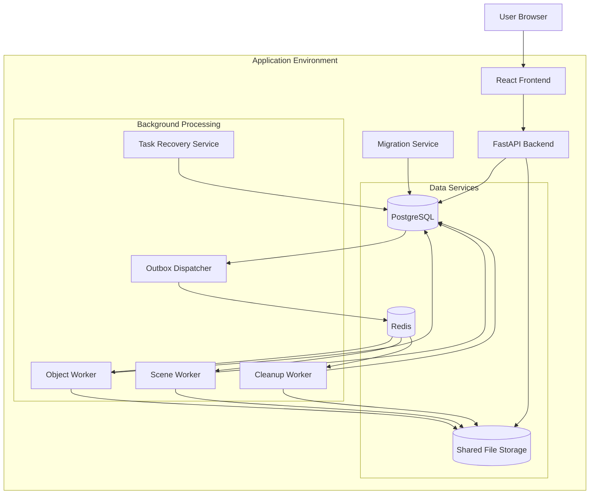

# 08 — Infrastructure Specification

## 1. Document Purpose

This document defines the infrastructure architecture and deployment requirements for the 3D generation web application.

It describes:

- Docker and Docker Compose architecture.
- Container responsibilities.
- Docker image organization.
- Service dependencies.
- PostgreSQL deployment.
- Redis deployment.
- Celery worker deployment.
- NVIDIA GPU access.
- Shared file storage.
- Persistent volumes.
- Environment configuration.
- Network configuration.
- Health checks.
- Logging and monitoring.
- Backup and recovery.
- Local development and production deployment.

The purpose of this specification is to ensure that all application components can be launched, configured and maintained through a consistent containerized environment.

The infrastructure must support independent execution of application services and computationally intensive ML workloads.

---

## 2. Infrastructure Architecture

### 2.1. General Architecture

Use Docker Compose as the primary orchestration tool for the MVP.

All application components must run as separate containers.

The initial deployment consists of:

1. Frontend.
2. FastAPI Backend.
3. PostgreSQL.
4. Redis.
5. Object Generation Worker.
6. Scene Reconstruction Worker.
7. Cleanup Worker.
8. Database Migration Service.
9. Outbox Dispatcher.
10. Task Recovery Service.

### 2.2. Infrastructure Diagram



### 2.3. Architectural Principles

- Each major subsystem must have its own Docker service.
- Application services must communicate through internal Docker networks.
- Persistent data must be stored in Docker Volumes or external persistent storage.
- ML workers must have separate Docker images and dependency environments.
- The API must not contain GPU-specific dependencies.
- GPU access must be configured only for services that require it.
- Container startup must respect service dependencies.
- Application services must support controlled restarts.
- Environment-specific settings must be configurable.
- Generated assets must survive container restarts.
- No service must depend on another container's internal filesystem except through explicitly shared volumes.

### 2.4. Development and Production Environments

Support two deployment configurations.

**Development**

- Vite development server.
- FastAPI with reload enabled.
- PostgreSQL.
- Redis.
- Object Worker.
- Scene Worker.
- Shared local storage.
- Optional direct host access to API and database.

**Production**

- Optimized frontend build served by Nginx.
- FastAPI running without development reload.
- Independent ML workers.
- Persistent database and file storage.
- Restricted internal service access.
- HTTPS termination through a reverse proxy.
- Production secrets configuration.

The application must support:

1. CPU-only development configuration.
2. NVIDIA GPU-enabled configuration.

The default Compose configuration must not require NVIDIA hardware.

GPU requirements must be activated through the GPU override file.

Development-only ports and debugging functionality must not be enabled by default in production.

---

## 3. Docker Services

## 3.1. Frontend Service

Service name:

`frontend`

Purpose:

Serve the React application.

Technology:

- Node.js.
- React.
- TypeScript.
- Vite.

Development mode:

- Run the Vite development server.
- Enable hot module replacement.
- Expose port 5173.
- Configure API proxy to the FastAPI service.

Production mode:

- Build optimized static assets.
- Serve the output through Nginx or an equivalent static web server.
- Proxy `/api/` requests to the backend.
- Do not include development dependencies in the production runtime image.

Recommended container configuration:

```yaml
frontend:
  build:
    context: ./frontend
    dockerfile: Dockerfile
  ports:
    - "5173:5173"
  depends_on:
    - api
```

This is a development-oriented example.

Production port mappings must be configured separately.

## 3.2. Backend API Service

Service name:

`api`

Purpose:

Run the FastAPI application.

Responsibilities:

- Authentication.
- REST API.
- Project management.
- Image uploads.
- Database operations.
- Task creation.
- Result retrieval.
- File download.
- Health checks.

The API service requires:

- PostgreSQL.
- Shared file storage.

The API does not require direct Redis access for generation task dispatch.

Generation messages are published by the Outbox Dispatcher.

Redis remains required for Celery, but it is not a direct dependency of FastAPI.

The API container must not contain:

- TripoSR model weights.
- Full PyTorch GPU environment.
- COLMAP processing binaries unless explicitly required for diagnostics.
- OpenMVS processing binaries.

The API image should remain significantly smaller and simpler than the ML worker images.

Startup command:

```bash
uvicorn app.main:app --host 0.0.0.0 --port 8000
```

Development mode may use:

```bash
uvicorn app.main:app --host 0.0.0.0 --port 8000 --reload
```

The `--reload` flag must not be used in production.

Expose port 8000 only for development or direct API access.

In production, route external requests through the frontend gateway or reverse proxy.

## 3.3. PostgreSQL Service

Service name:

`db`

Purpose:

Store application metadata and relational data.

Responsibilities:

- User accounts.
- Authentication sessions.
- Projects.
- Uploaded image metadata.
- Generation tasks.
- Generation task image references.
- Generated result metadata.
- Cleanup job records.
- Outbox messages.

Requirements:

- Use the official PostgreSQL Docker image.
- Pin a tested major version.
- Use environment-based initialization credentials.
- Use a persistent Docker Volume.
- Expose PostgreSQL only inside the internal application network by default.
- Enable health checks.
- Configure persistent database storage.

Example:

```yaml
db:
  image: postgres:17
  environment:
    POSTGRES_DB: ${POSTGRES_DB}
    POSTGRES_USER: ${POSTGRES_USER}
    POSTGRES_PASSWORD: ${POSTGRES_PASSWORD}
  volumes:
    - postgres_data:/var/lib/postgresql/data
  healthcheck:
    test:
      - CMD-SHELL
      - pg_isready -U ${POSTGRES_USER} -d ${POSTGRES_DB}
    interval: 10s
    timeout: 5s
    retries: 5
    start_period: 10s
```

The image tag is an example of version pinning.

The actual PostgreSQL version must be selected and tested before deployment. Do not use an unpinned `latest` tag.

Production credentials must be managed through an appropriate secrets mechanism.

## 3.4. Redis Service

Service name:

`redis`

Purpose:

Provide message broker functionality for Celery.

Responsibilities:

- Receive background task messages.
- Hold pending generation tasks.
- Distribute messages to workers.
- Support communication between the dispatcher and workers.

Requirements:

- Use an official Redis image.
- Pin a tested version.
- Enable persistent storage where required.
- Use a dedicated Docker Volume.
- Expose Redis only through the internal application network.
- Enable health checks.
- Do not treat Redis as the primary source of task status.

Example:

```yaml
redis:
  image: redis:7.4-alpine
  command: redis-server --appendonly yes
  volumes:
    - redis_data:/data
  healthcheck:
    test:
      - CMD
      - redis-cli
      - ping
    interval: 10s
    timeout: 5s
    retries: 5
```

The version shown is an example. Use a verified release compatible with the selected Celery and Redis client versions.

### Redis Persistence

For the MVP:

- Enable AOF persistence.
- Store Redis persistence data in a Docker Volume.
- Configure backup and recovery procedures where necessary.

Redis persistence helps recover broker data after restarts but does not replace PostgreSQL task records.

PostgreSQL remains the authoritative source for generation task state.

Redis broker messages must be recoverable through the persistent dispatch mechanism.

## 3.5. Object Generation Worker

Service name:

`object-worker`

Purpose:

Execute individual 3D object generation tasks using TripoSR.

Responsibilities:

- Initialize TripoSR.
- Load model weights.
- Access NVIDIA GPU when available.
- Retrieve source photographs.
- Perform image preprocessing.
- Execute model inference.
- Extract mesh geometry.
- Export GLB.
- Validate generated assets.
- Store results.
- Update task status.

Requirements:

- Use an independent Docker image.
- Use a separate Python dependency environment.
- Support persistent model cache.
- Access shared file storage.
- Access PostgreSQL.
- Access Redis.
- Support configurable worker concurrency.

The worker must not be built from the main FastAPI Dockerfile.

Recommended initial concurrency:

```text
OBJECT_WORKER_CONCURRENCY=1
```

This prevents multiple large inference operations from unnecessarily competing for GPU memory.

## 3.6. Scene Reconstruction Worker

Service name:

`scene-worker`

Purpose:

Execute photogrammetric scene reconstruction.

Responsibilities:

- Retrieve source photographs.
- Prepare COLMAP workspace.
- Run feature extraction.
- Run feature matching.
- Execute sparse reconstruction.
- Validate camera poses.
- Execute image undistortion.
- Import COLMAP reconstruction into OpenMVS.
- Generate dense point cloud.
- Generate mesh.
- Refine mesh.
- Generate textures.
- Export GLB.
- Validate results.

Requirements:

- Use an independent Docker image.
- Include COLMAP executables.
- Include OpenMVS executables.
- Include all required native libraries.
- Access shared storage.
- Access PostgreSQL.
- Access Redis.
- Support configurable CPU and GPU resource allocation.

Recommended initial concurrency:

```text
SCENE_WORKER_CONCURRENCY=1
```

The initial configuration should prioritize reconstruction reliability rather than maximum parallel processing.

## 3.7. Cleanup Worker

Service name:

`cleanup-worker`

Purpose:

Execute file cleanup operations.

Responsibilities:

- Retrieve pending cleanup jobs.
- Remove obsolete files.
- Remove temporary directories.
- Clean up expired processing artifacts.
- Update cleanup job status.
- Retry recoverable failures.

Requirements:

- Access PostgreSQL.
- Access shared file storage.
- Access Redis.
- Use a dedicated Celery queue.

The cleanup worker must never delete files belonging to active processing tasks.

## 3.8. Database Migration Service

Service name:

`migration`

Purpose:

Apply Alembic database migrations before starting application services.

Execution command:

```bash
alembic upgrade head
```

Requirements:

- Use the same backend source code and database configuration as the API.
- Wait until PostgreSQL is healthy.
- Run as a one-time process.
- Exit with a non-zero code if migration fails.
- Do not run migrations independently from every API container.

The API and workers must start only after the required database migration service completes successfully.

## 3.9. Outbox Dispatcher

Service name:

`outbox-dispatcher`

Purpose:

Reliably publish generation tasks from PostgreSQL to Redis.

The Outbox Dispatcher must:

- Depend on healthy PostgreSQL and Redis services.
- Execute as an independent container.
- Use the application database schema.
- Publish messages to the configured Celery queues.
- Recover expired message locks.
- Support at-least-once publication.

Operational sequence:

1. Claim pending outbox messages with `FOR UPDATE SKIP LOCKED`.
2. Set them to `PROCESSING`, record `locked_at` and `locked_by`, and increment `attempts`.
3. Commit the claiming transaction.
4. Publish the corresponding Celery task.
5. Mark the message as `PUBLISHED` in a separate transaction.
6. On failure, return the message to `PENDING`, record `last_error` and set `available_at` according to the retry policy in `05_database_specification.md`, Section 13.6.
7. Retry temporary publishing failures.
8. Avoid losing tasks after API or Redis interruptions.

This service implements the Transactional Outbox pattern.

The dispatcher must not hold a PostgreSQL row lock while waiting on Redis.

An expired `PROCESSING` lock must be released automatically after the configured lock timeout.

The outbox schema is defined in `05_database_specification.md`. It contains the message identifier, event type, aggregate type and identifier, payload, schema version, status, attempts, availability time, lock metadata, publication timestamp, last error and creation timestamp.

The dispatcher should be implemented as a lightweight independent process.

## 3.10. Task Recovery Service

Service name:

`task-recovery`

Purpose:

Detect and recover generation tasks whose worker has stopped or lost its lease.

Responsibilities:

- Periodically inspect generation tasks that remain in `PROCESSING`.
- Check `heartbeat_at` and `lease_expires_at`.
- Detect workers that have finished or disappeared.
- Return a task to `PENDING` when safe repeated execution is possible.
- Create a new outbox event for redelivery.
- Move tasks that cannot be recovered to `FAILED`.
- Respect cancellation and project deletion instead of requeueing such tasks.

Requirements:

- Access PostgreSQL.
- Treat PostgreSQL as the authoritative task state store.
- Use atomic conditional updates when changing task state.
- Remain safe when several recovery instances run concurrently.
- Never bypass the Transactional Outbox.

The Task Recovery service must not publish Celery messages to Redis directly. It creates `outbox_messages` rows, and the Outbox Dispatcher publishes them.

A task whose project has been deleted or whose `cancel_requested_at` is set must not be requeued. It must be moved to `CANCELLED` once its worker has stopped.

---

## 4. Docker Image Organization

### 4.1. Image Separation

Build separate images:

```text
frontend/
    Dockerfile

backend/
    Dockerfile

ml/
    object_generation/
        Dockerfile

    scene_reconstruction/
        Dockerfile

    workers/
        Dockerfile
```

The exact paths may be adjusted to the final repository structure.

### 4.2. Backend Image

The Backend image must contain:

- Python runtime.
- FastAPI.
- Uvicorn.
- SQLAlchemy.
- Alembic.
- Pydantic.
- Redis client.
- Celery.
- Application dependencies.

The API process must not open a Redis connection. Redis and Celery client libraries in the backend image support the Outbox Dispatcher and other backend services built from the same image.

It must not include large ML model weights.

### 4.3. Object Worker Image

The Object Worker image must contain:

- Compatible Python runtime.
- PyTorch.
- Compatible CUDA runtime dependencies.
- TripoSR.
- Image preprocessing libraries.
- Mesh processing libraries.
- GLB export dependencies.
- Celery worker dependencies.

Use a multi-stage Docker build where appropriate.

Keep model weights outside the immutable application image when practical.

Store weights in a mounted model cache volume.

### 4.4. Scene Worker Image

The Scene Worker image must contain:

- Compatible Linux runtime.
- COLMAP.
- OpenMVS.
- CUDA runtime dependencies if using GPU-enabled builds.
- Native library dependencies.
- Python.
- Celery.
- Processing orchestration modules.

COLMAP and OpenMVS must be installed and tested inside the final runtime image.

Do not assume that a successful build implies all external executables are operational.

Verify the availability of:

```bash
colmap --help
InterfaceCOLMAP --help
DensifyPointCloud --help
ReconstructMesh --help
RefineMesh --help
TextureMesh --help
TransformScene --help
```

Some command-line options may vary by version.

### 4.5. Image Versioning

- Pin base image versions.
- Pin major dependency versions.
- Pin ML repository revisions.
- Pin model weight revisions.
- Record installed versions.
- Avoid relying on unpinned `latest` tags.
- Rebuild images after dependency changes.

### 4.6. Image Size Optimization

- Use multi-stage builds.
- Separate build and runtime dependencies.
- Remove package manager caches.
- Avoid copying unnecessary repository files.
- Exclude local datasets and generated results from Docker build contexts.
- Use `.dockerignore`.
- Keep model checkpoints in persistent volumes.

---

## 5. Docker Compose Configuration

### 5.1. Main Compose File

The primary configuration must be stored in:

`compose.yaml`

It must define:

- Frontend.
- API.
- PostgreSQL.
- Redis.
- Object Worker.
- Scene Worker.
- Cleanup Worker.
- Migration Service.
- Outbox Dispatcher.
- Task Recovery Service.
- Shared networks.
- Persistent volumes.

### 5.2. Service Dependencies

Use `depends_on` and health checks where service readiness matters.

Recommended dependencies:

| Service | Dependencies |
|---|---|
| Frontend | API |
| API | PostgreSQL, shared file storage, successful migrations |
| Object Worker | PostgreSQL, Redis, successful migrations |
| Scene Worker | PostgreSQL, Redis, successful migrations |
| Cleanup Worker | PostgreSQL, Redis, successful migrations |
| Outbox Dispatcher | PostgreSQL, Redis, successful migrations |
| `task-recovery` | PostgreSQL, successful migrations |
| Migration | Healthy PostgreSQL |

Container creation does not automatically mean that a dependent service is ready to accept connections.

Use `service_healthy` for essential dependencies and `service_completed_successfully` for the migration service.

The application must still handle dependency interruptions after startup.

### 5.3. Persistent Volumes

Define the following named volumes:

```yaml
volumes:
  postgres_data:
  redis_data:
  app_data:
  triposr_model_cache:
```

Purpose:

| Volume | Contents |
|---|---|
| postgres_data | PostgreSQL database files |
| redis_data | Redis persistence files |
| app_data | Source photographs, generated models and intermediate files |
| triposr_model_cache | Downloaded TripoSR weights and cache |

The `app_data` volume must be shared between:

- API.
- Object Worker.
- Scene Worker.
- Cleanup Worker.

All services must mount it to the same internal path:

```text
/data
```

This requirement is essential because a storage reference written by one service must resolve to the same physical file when accessed by another service.

The frontend must not mount the application storage volume.

The `triposr_model_cache` volume must be mounted only into the Object Worker, at the configured model cache path.

The model cache must not be included in the general application file storage volume.

This keeps user files and neural-network weights separate and prevents accidental cleanup of model data.

### 5.4. Worker Storage Permissions

Configure container users and file permissions consistently.

The API must be able to create source files.

Workers must be able to read source files and create processing outputs.

The cleanup worker must be able to remove authorized storage objects.

Avoid running all containers as root unless a specific native dependency makes it necessary and the risk is documented.

### 5.5. Shared Storage Layout

All services must use the same logical storage root.

Recommended structure:

```text
/data/
│
├── projects/
│   └── {project_id}/
│       ├── source/
│       ├── working/
│       │   ├── object/
│       │   └── scene/
│       │
│       └── results/
│
└── temporary/
```

The exact storage layout is defined by the backend and ML specifications.

The infrastructure configuration must preserve the shared path.

---

## 6. GPU Configuration

### 6.1. General Requirements

The system should support NVIDIA GPU acceleration for ML workloads.

GPU access is required only for services that actually use CUDA.

The FastAPI service, frontend and PostgreSQL must not require GPU access.

### 6.2. Host Requirements

A GPU-enabled deployment requires:

- Compatible NVIDIA GPU.
- Installed NVIDIA host driver.
- Docker Engine or compatible Docker runtime.
- NVIDIA Container Toolkit.
- Correct Docker runtime configuration.
- CUDA-compatible worker images.

Installing CUDA inside a container does not replace the NVIDIA driver installed on the host.

### 6.3. NVIDIA Container Toolkit

On supported Linux hosts, install and configure NVIDIA Container Toolkit according to official NVIDIA documentation.

Typical Docker configuration command:

```bash
sudo nvidia-ctk runtime configure --runtime=docker
```

Restart Docker after applying the runtime configuration:

```bash
sudo systemctl restart docker
```

Verify that GPU access works before launching the entire application:

```bash
docker run --rm --gpus all \
  nvidia/cuda:<compatible-version>-base-ubuntu22.04 \
  nvidia-smi
```

Select a CUDA image version compatible with the host driver and worker build.

### 6.4. Docker Compose GPU Reservations

Use a separate GPU override file:

`compose.gpu.yaml`

This allows the basic application to run without requiring NVIDIA hardware.

Example:

```yaml
services:
  object-worker:
    deploy:
      resources:
        reservations:
          devices:
            - driver: nvidia
              count: 1
              capabilities: [gpu]
```

For a GPU-enabled Scene Worker, add a separate reservation after verifying that its COLMAP/OpenMVS builds support the required GPU operations.

The `count` and `device_ids` settings must not be configured together.

### 6.5. GPU Assignment

Initial recommended configuration:

| Service | GPU |
|---|---|
| API | No |
| Frontend | No |
| PostgreSQL | No |
| Redis | No |
| Object Worker | Yes, recommended |
| Scene Worker | Optional |
| Cleanup Worker | No |

Object Generation should use CUDA by default when a compatible GPU is available.

Scene Reconstruction should remain functional on CPU even when optional CUDA acceleration is unavailable.

### 6.6. CPU-Only Development

The system must support an environment without NVIDIA GPU access.

Requirements:

- API must start normally.
- Frontend must start normally.
- PostgreSQL and Redis must start normally.
- Scene Worker must support its CPU configuration.
- Object Worker may use explicit CPU fallback when configured.

Do not silently pretend that GPU processing is enabled when it is unavailable.

A worker that cannot execute its configured algorithm must report itself as unavailable.

### 6.7. GPU Resource Isolation

Configure worker concurrency conservatively.

Initial values:

```env
OBJECT_WORKER_CONCURRENCY=1
SCENE_WORKER_CONCURRENCY=1
```

Workers must not oversubscribe GPU memory.

For a multi-GPU environment, GPU assignment may be controlled using Docker Compose device identifiers.

GPU allocation must be tested on the actual deployment hardware.

---

## 7. Redis and Celery Infrastructure

### 7.1. Redis Responsibilities

Redis serves as the message broker.

It must not be the only storage location for task lifecycle information.

PostgreSQL remains authoritative.

### 7.2. Celery Queues

Create the following queues:

```text
object_generation
scene_reconstruction
file_cleanup
```

Task routing:

| Task | Queue | Worker |
|---|---|---|
| generate_object_task | object_generation | object-worker |
| reconstruct_scene_task | scene_reconstruction | scene-worker |
| cleanup_storage_task | file_cleanup | cleanup-worker |

### 7.3. Worker Commands

Object Worker:

```bash
celery -A workers.celery_app worker \
  -Q object_generation \
  --concurrency=1 \
  --loglevel=INFO
```

Scene Worker:

```bash
celery -A workers.celery_app worker \
  -Q scene_reconstruction \
  --concurrency=1 \
  --loglevel=INFO
```

Cleanup Worker:

```bash
celery -A workers.celery_app worker \
  -Q file_cleanup \
  --concurrency=2 \
  --loglevel=INFO
```

The exact concurrency values must be configurable.

### 7.4. Queue Isolation

Workers must consume only their assigned queues.

A Scene Worker must not accidentally consume Object Generation tasks.

The dispatcher must route task types correctly.

### 7.5. Celery Reliability

Configure:

- Explicit task routing.
- Task execution timeouts.
- Bounded retries.
- Worker health monitoring.
- Task idempotency.
- Appropriate acknowledgement settings.
- Controlled worker concurrency.

Use a low prefetch multiplier for long-running reconstruction tasks.

Task completion and failure must be persisted in PostgreSQL.

Do not rely exclusively on Celery's result backend.

### 7.6. Celery Result Backend

For the MVP, do not configure a separate Celery result backend.

All generation statuses and results are stored in PostgreSQL. A second competing task-state store is unnecessary.

Set:

```env
CELERY_TASK_IGNORE_RESULT=true
```

Do not configure `CELERY_RESULT_BACKEND`.

Task completion and failure must be persisted in PostgreSQL, not read from a Celery backend.

---

## 8. Networking

### 8.1. General Network Structure

Use an internal Docker Compose network for communication between application services.

Recommended logical network:

```text
application_network
```

Containers must communicate using Docker Compose service names.

Examples:

```text
db:5432
redis:6379
api:8000
```

Do not use container IP addresses in application configuration.

### 8.2. Port Exposure

Development:

| Service | Container Port | Host Port |
|---|---:|---:|
| Frontend | 5173 | 5173 |
| API | 8000 | 8000 |
| PostgreSQL | 5432 | Optional 5432 |
| Redis | 6379 | Optional 6379 |

Production:

- Expose only the reverse proxy or gateway publicly.
- Do not expose PostgreSQL.
- Do not expose Redis.
- Do not expose Celery worker ports.
- Do not expose internal storage directories.

### 8.3. Frontend/API Communication

During development:

- The Vite server may proxy `/api` requests to FastAPI.
- API origin and allowed CORS origins must be configured consistently.

In production:

- Nginx serves the frontend application.
- Nginx proxies `/api/` requests to FastAPI.
- The frontend uses relative API paths where practical.

This arrangement simplifies cookie authentication and reduces unnecessary cross-origin configuration.

### 8.4. Internal Service Access

Only the services that require database access should be connected to PostgreSQL.

Only the Outbox Dispatcher and Celery workers should access Redis.

The API must not use Redis for generation task dispatch.

The frontend must never connect directly to PostgreSQL or Redis.

---

## 9. Environment Configuration

### 9.1. General Requirements

All environment-specific settings must be configurable.

Use:

- `.env.example` for documented variables.
- `.env` for local development.
- Secure environment injection for production.

Do not commit actual secrets to version control.

### 9.2. Example Environment File

```env
# Application
APP_ENV=development
DEBUG=true

# Frontend
FRONTEND_PORT=5173

# Backend
API_HOST=0.0.0.0
API_PORT=8000

# PostgreSQL
POSTGRES_DB=app
POSTGRES_USER=app
POSTGRES_PASSWORD=change_me
DATABASE_URL=postgresql+psycopg://app:change_me@db:5432/app

# Redis
REDIS_URL=redis://redis:6379/0

# Celery
CELERY_BROKER_URL=redis://redis:6379/1
CELERY_TASK_IGNORE_RESULT=true

# Outbox dispatcher
OUTBOX_RETRY_BASE_SECONDS=2
OUTBOX_RETRY_MAX_SECONDS=300
OUTBOX_MAX_ATTEMPTS=10
OUTBOX_LOCK_TIMEOUT_SECONDS=60

# Worker leases and recovery
TASK_LEASE_SECONDS=300
TASK_HEARTBEAT_SECONDS=30
TASK_STALE_THRESHOLD_SECONDS=900
DISPATCH_STALL_TIMEOUT_SECONDS=900

# Storage
STORAGE_ROOT=/data
MAX_UPLOAD_SIZE_MB=20
MAX_SCENE_IMAGES=100
MIN_SCENE_IMAGES=3

# Workers
OBJECT_WORKER_CONCURRENCY=1
SCENE_WORKER_CONCURRENCY=1
CLEANUP_WORKER_CONCURRENCY=2

# TripoSR
OBJECT_DEVICE=cuda:0
OBJECT_ALLOW_CPU_FALLBACK=false
OBJECT_CHUNK_SIZE=8192
OBJECT_MC_RESOLUTION=256

# Scene Reconstruction
SCENE_COLMAP_USE_GPU=true
SCENE_OPENMVS_USE_CUDA=false
SCENE_MAX_THREADS=4
SCENE_MAX_IMAGE_SIZE=2000

# Model cache
MODEL_CACHE_ROOT=/models/triposr
```

Values shown are initial development defaults.

Actual configuration must be validated against the installed libraries and available hardware.

### 9.3. Secret Management

Production deployments must not use development credentials.

Use Docker secrets, an external secrets manager or secure deployment environment variables where appropriate.

Do not:

- Commit `.env`.
- Store passwords in Dockerfiles.
- Expose secrets through frontend environment variables.
- Print secrets in logs.
- Include credentials in build arguments.

---

## 10. Health Checks and Startup Management

### 10.1. Health Checks

Configure health checks for essential services.

| Service | Health Check |
|---|---|
| PostgreSQL | `pg_isready` |
| Redis | `redis-cli ping` |
| API | `/health/ready` |
| Frontend | HTTP request to application endpoint |
| Object Worker | Worker process and model readiness |
| Scene Worker | Worker process and executable readiness |
| Cleanup Worker | Worker process readiness |
| Outbox Dispatcher | Dispatcher process and dependency readiness |
| Task Recovery | Recovery process and dependency readiness |

Worker health checks must distinguish between a running Celery process and a worker capable of accepting its assigned tasks.

For Object Worker, readiness may also include successful model initialization.

### 10.2. Startup Order

Recommended startup sequence:

```text
1. PostgreSQL
2. Redis
3. Database Migrations
4. API
5. Celery Workers
6. Task Recovery Service
7. Outbox Dispatcher
8. Frontend / Reverse Proxy
```

Docker Compose dependencies must reflect this order where required.

Use health checks rather than relying exclusively on container startup order.

### 10.3. Restart Policies

Recommended policies:

| Service | Restart Policy |
|---|---|
| PostgreSQL | unless-stopped |
| Redis | unless-stopped |
| API | unless-stopped |
| Frontend | unless-stopped |
| Object Worker | unless-stopped |
| Scene Worker | unless-stopped |
| Cleanup Worker | unless-stopped |
| Outbox Dispatcher | unless-stopped |
| Task Recovery | unless-stopped |
| Migration | no |

A restart policy does not replace application-level error recovery.

### 10.4. Dependency Failure

Application services must handle temporary dependency outages.

Examples:

- Redis unavailable during dispatch.
- PostgreSQL unavailable during API request handling.
- Worker disconnected from Redis.
- Shared storage temporarily unavailable.

When a dependency becomes unavailable, the application must not silently report successful operations.

---

## 11. File Storage and Persistence

### 11.1. Storage Strategy

Use a shared Docker Volume for application files.

The initial implementation must use local persistent storage.

The storage root must be configurable.

### 11.2. Persistence Requirements

Uploaded photographs and completed generated models must survive:

- Container restarts.
- Container recreation.
- Application rebuilds.

Do not store important user assets only in container writable layers.

### 11.3. Storage Access

The following services must mount shared storage:

- API.
- Object Worker.
- Scene Worker.
- Cleanup Worker.

Use the same internal storage path for every service.

### 11.4. Intermediate Files

Intermediate COLMAP/OpenMVS files and TripoSR processing files must be written to task-specific directories.

Configure cleanup policies to prevent unlimited disk consumption.

Keep useful diagnostic artifacts for an appropriate retention period.

### 11.5. Future Storage Migration

The storage architecture should allow migration to S3-compatible storage.

This may be implemented using:

- MinIO.
- Amazon S3.
- Another compatible object storage service.

This migration is outside the MVP scope.

---

## 12. Backup and Recovery

### 12.1. PostgreSQL Backup

Provide a documented procedure for database backups.

Use PostgreSQL backup tools such as:

```bash
pg_dump
```

Store backup files outside the database container.

A Docker Volume alone is not considered a backup.

### 12.2. File Storage Backup

Back up:

- Uploaded source photographs.
- Current generated models.
- Historical assets according to retention requirements.
- Important metadata or manifests needed for restoration.

Storage backups must be independent of container lifecycle.

### 12.3. Redis Backup

Redis is used as a message broker.

The authoritative generation status is stored in PostgreSQL.

Redis AOF persistence improves broker recovery but does not remove the need for task reconciliation and republishing.

### 12.4. Recovery

The recovery process must support:

1. Restoring PostgreSQL.
2. Restoring application file storage.
3. Restarting Redis.
4. Starting API and worker services.
5. Recovering pending or interrupted generation tasks.
6. Reprocessing unpublished outbox messages.
7. Verifying project/result consistency.

### 12.5. Consistency Verification

After recovery, verify:

- No projects reference missing results without a corresponding failure state.
- No current result references a nonexistent file.
- No active task remains permanently stuck in PROCESSING.
- Pending cleanup jobs remain available.
- Unpublished outbox messages can be dispatched.
- No outbox message remains stuck in `PROCESSING` with an expired lock.

---

## 13. Logging and Monitoring

### 13.1. Logging

Services should write logs to standard output and standard error.

Docker must be able to collect service logs using:

```bash
docker compose logs
```

### 13.2. Log Rotation

Configure logging limits for long-running containers.

Avoid unlimited Docker log growth.

### 13.3. Required Log Information

Logs should include:

- Service name.
- Timestamp.
- Log level.
- Request ID where applicable.
- Project ID.
- Generation task ID.
- Processing stage.
- Error code.
- Execution duration.

Do not log:

- Passwords.
- Session tokens.
- CSRF tokens.
- Sensitive user information.
- Full uploaded file contents.

### 13.4. Monitoring

The MVP should provide enough information to diagnose:

- Container startup failures.
- PostgreSQL connectivity problems.
- Redis connectivity problems.
- Celery worker failures.
- GPU initialization failures.
- ML task failures.
- Disk space exhaustion.
- Storage permission issues.

Advanced monitoring dashboards and distributed tracing are future improvements.

---

## 14. Docker Compose Commands

The application must provide documented commands for the main development and deployment operations.

### 14.1. Validate Configuration

Before starting services:

```bash
docker compose config
```

The command must complete without configuration errors.

### 14.2. Build Images

```bash
docker compose build
```

### 14.3. Start Application

```bash
docker compose up -d
```

### 14.4. Start with GPU Support

```bash
docker compose \
  -f compose.yaml \
  -f compose.gpu.yaml \
  up -d --build
```

This requires an appropriately configured NVIDIA-enabled Docker host.

### 14.5. View Containers

```bash
docker compose ps
```

### 14.6. View Logs

```bash
docker compose logs -f
```

Specific service:

```bash
docker compose logs -f api
docker compose logs -f object-worker
docker compose logs -f scene-worker
```

### 14.7. Stop Application

```bash
docker compose down
```

Stopping containers must not delete named volumes.

### 14.8. Stop and Delete Volumes

The following command is destructive:

```bash
docker compose down -v
```

It may permanently remove:

- PostgreSQL data.
- Redis persistence files.
- Uploaded photographs.
- Generated 3D models.
- Cached model weights.

Document this operation clearly.

Do not use it as part of ordinary development shutdown procedures.

---

## 15. Development Workflow

### 15.1. Initial Environment Setup

The development environment must provide:

- Docker.
- Docker Compose.
- Git.
- Compatible Python tooling where local development is required.
- Node.js where local frontend development is required.
- NVIDIA drivers and Container Toolkit for GPU execution.

The documented development hardware profile, including CPU, RAM, GPU, VRAM and disk requirements, is recorded in `architecture/phase0_decisions.md`.

### 15.2. Repository Structure

Infrastructure files should be located in:

```text
project/
│
├── frontend/
├── backend/
├── ml/
│   ├── object_generation/
│   ├── scene_reconstruction/
│   └── workers/
│
├── infrastructure/
│   ├── docker/
│   │   ├── frontend/
│   │   ├── backend/
│   │   ├── object-worker/
│   │   └── scene-worker/
│   │
│   ├── nginx/
│   ├── redis/
│   └── scripts/
│
├── docs/
│
├── compose.yaml
├── compose.gpu.yaml
├── .env.example
├── .gitignore
└── README.md
```

### 15.3. Development Isolation

Developers should be able to rebuild an individual service without rebuilding all other images.

Examples:

```bash
docker compose build api
docker compose build frontend
docker compose build object-worker
docker compose build scene-worker
```

### 15.4. Database Initialization

Database migrations must be applied before API operation.

Provide documented commands for:

- Applying migrations.
- Checking current migration version.
- Rolling back a migration when supported.

### 15.5. ML Model Initialization

TripoSR weights must be downloaded or mounted separately from application source code.

The Scene Worker must verify the availability of all required reconstruction executables during initialization.

Missing dependencies must produce explicit startup errors.

### 15.6. Development Debugging

Provide access to logs for individual containers.

Allow developers to restart or rebuild individual workers.

Keep processing directories available for debugging failed tasks according to the configured retention policy.

---

## 16. Production Deployment Considerations

Although Docker Compose is the primary MVP deployment mechanism, the architecture should not depend on a single physical host.

### 16.1. Service Separation

Future deployment may separate:

- Frontend gateway.
- API servers.
- PostgreSQL.
- Redis.
- Object Generation Workers.
- Scene Reconstruction Workers.
- Object Storage.

### 16.2. Dedicated GPU Server

ML workloads may be transferred to another machine.

In this case:

- The API continues to manage projects and tasks.
- Redis transports task messages.
- Workers connect to the shared broker.
- Workers use accessible persistent storage.
- PostgreSQL stores task state and results.

If workers run on a separate machine, local Docker Volumes cannot be shared automatically.

Use network-accessible object storage, a shared filesystem or an explicit asset-transfer mechanism.

### 16.3. Horizontal Scaling

The following components may be scaled independently:

- Frontend.
- API.
- Object Workers.
- Scene Workers.
- Cleanup Workers.
- Outbox Dispatchers.
- Task Recovery services.

ML worker scaling must consider hardware limitations.

Do not assume that multiple worker containers can efficiently share one GPU.

### 16.4. Future Orchestration

Kubernetes or another orchestration platform may be introduced in a later development phase.

The MVP must not require Kubernetes.

All services must remain independently containerized so that future migration is possible.

---

## 17. Security Requirements

### 17.1. Container Security

- Use trusted base images.
- Pin image versions.
- Avoid running containers as root where possible.
- Keep images updated.
- Minimize installed packages.
- Avoid exposing unnecessary ports.
- Restrict filesystem mounts.
- Do not mount the Docker socket inside application containers.

### 17.2. Network Security

- Keep PostgreSQL private.
- Keep Redis private.
- Do not expose worker services publicly.
- Expose only necessary frontend/API entry points.
- Configure allowed origins explicitly.

### 17.3. Secrets

Production secrets must be provided securely.

Do not commit `.env` files containing actual credentials.

Do not include secrets in image layers.

### 17.4. Storage Security

- Use restricted access to persistent volumes.
- Do not serve storage directories as public static directories.
- Ensure uploaded files are accessed through authorized backend operations.
- Prevent path traversal.
- Keep user data isolated by project ownership.

### 17.5. Resource Protection

Configure reasonable resource limits where appropriate.

Protect the system against:

- Excessively large image collections.
- Multiple concurrent heavy tasks.
- Unbounded temporary storage growth.
- Redis memory exhaustion.
- Database connection exhaustion.
- Worker process leaks.

---

## 18. Testing Requirements

### 18.1. Docker Configuration Tests

Verify:

- Compose configuration is valid.
- All image builds complete.
- Required volumes are configured.
- Required networks exist.
- Environment variables are resolved.
- Service dependencies are valid.

### 18.2. Service Startup Tests

Verify:

- PostgreSQL becomes healthy.
- Redis becomes healthy.
- Migrations execute successfully.
- API starts.
- Workers start.
- Frontend starts.
- Dispatcher starts.
- Task Recovery starts.

### 18.3. Persistence Tests

Verify:

1. Upload a photograph.
2. Create a generated result.
3. Restart the relevant containers.
4. Confirm the photograph still exists.
5. Confirm the result still exists.
6. Confirm PostgreSQL retains the metadata.

### 18.4. GPU Tests

For GPU-enabled environments:

- Verify NVIDIA runtime access.
- Verify CUDA visibility inside the Object Worker.
- Verify PyTorch detects the GPU.
- Verify TripoSR initializes.
- Verify the worker can execute inference.
- Verify GPU memory errors are handled.

### 18.5. Worker Tests

Verify:

- Object tasks reach Object Worker.
- Scene tasks reach Scene Worker.
- Cleanup jobs reach Cleanup Worker.
- Workers consume only their designated queues.
- Worker restarts do not permanently lose task state.

### 18.6. Failure Tests

Test:

- PostgreSQL unavailable.
- Redis unavailable.
- Worker unavailable.
- GPU unavailable.
- Missing model weights.
- Missing COLMAP executable.
- Missing OpenMVS executable.
- Storage volume unavailable.
- Insufficient disk space.
- Container restart during processing.

### 18.7. Recovery Tests

Verify that the application can recover from interrupted operations without corrupting project state or deleting previously generated results.

---

## 19. Acceptance Criteria

### INF-AC-01. Compose Validation

`docker compose config` completes without configuration errors.

### INF-AC-02. Image Build

All required application images build successfully.

### INF-AC-03. Database Startup

PostgreSQL starts and passes its configured health check.

### INF-AC-04. Redis Startup

Redis starts and passes its configured health check.

### INF-AC-05. Migrations

Database migrations execute successfully before API initialization.

### INF-AC-06. API Startup

FastAPI starts and exposes its health endpoints.

### INF-AC-07. Frontend Startup

The React application starts and communicates with FastAPI.

### INF-AC-08. Object Worker Startup

The Object Worker initializes the TripoSR execution environment.

### INF-AC-09. Scene Worker Startup

The Scene Worker detects and executes COLMAP/OpenMVS binaries.

### INF-AC-10. Queue Separation

Object, scene and cleanup tasks are delivered to their respective workers.

### INF-AC-11. Persistent Storage

Source images and generated assets survive container recreation.

### INF-AC-12. Shared Storage

API and worker services resolve the same storage keys to the same persistent files.

### INF-AC-13. GPU Access

The GPU-enabled configuration provides access to the assigned GPU when supported host prerequisites are satisfied.

### INF-AC-14. CPU Configuration

The application can start without NVIDIA GPU access.

### INF-AC-15. Health Checks

Essential infrastructure services expose working health checks.

### INF-AC-16. Dependency Ordering

Dependent services start only after their required dependencies become healthy or complete successfully.

### INF-AC-17. Logging

Service logs are available through Docker Compose.

### INF-AC-18. Recovery

The application recovers from supported container restarts and dependency interruptions.

### INF-AC-19. Backup

Documented backup and restoration procedures exist for PostgreSQL and application file storage.

### INF-AC-20. Security

Production configuration does not publicly expose PostgreSQL, Redis, worker services or user file storage.

### INF-AC-21. Outbox Dispatcher Independence

The Outbox Dispatcher starts independently and recovers pending messages.

### INF-AC-22. Task Recovery Independence

The Task Recovery service starts independently and can requeue or fail stale tasks.

### INF-AC-23. API Without Direct Redis Access

The API operates and accepts generation requests without direct Redis access.

### INF-AC-24. Recoverability During Redis Outage

Generation requests remain recoverable during Redis outages.

### INF-AC-25. Persistent Worker Lease State

Worker leases and heartbeat information are persisted in PostgreSQL and survive service restarts.

---

## 20. Implementation Order

### Phase 1. Docker Foundation

- Create infrastructure directory.
- Create backend Dockerfile.
- Create frontend Dockerfile.
- Create initial Compose configuration.
- Configure `.env.example`.
- Configure `.dockerignore`.
- Configure shared networks and volumes.

### Phase 2. Data Services

- Configure PostgreSQL.
- Configure Redis.
- Add persistent volumes.
- Add health checks.
- Test restart persistence.

### Phase 3. Backend Deployment

- Build FastAPI image.
- Configure environment variables.
- Configure database connection.
- Configure Alembic migration service.
- Configure API health checks.

### Phase 4. Frontend Deployment

- Build React image.
- Configure Vite development server.
- Configure API proxy.
- Test frontend/backend communication.
- Implement production static serving.

### Phase 5. Background Processing

- Configure Celery.
- Create dedicated queues.
- Create Object Worker service.
- Create Scene Worker service.
- Create Cleanup Worker service.
- Create Outbox Dispatcher.
- Create Task Recovery service.
- Test queue routing.

### Phase 6. ML Environments

- Build TripoSR worker image.
- Configure model cache.
- Verify GPU access.
- Build COLMAP/OpenMVS worker image.
- Verify native binaries.
- Test independent execution.

### Phase 7. Storage and Recovery

- Configure shared storage.
- Configure file permissions.
- Test asset persistence.
- Implement cleanup jobs.
- Implement backups.
- Test recovery.

### Phase 8. Final Verification

- Validate Compose configuration.
- Build all images.
- Start all services.
- Run health checks.
- Execute object generation integration test.
- Execute scene reconstruction integration test.
- Verify GLB delivery.
- Verify service restart behavior.
- Document startup procedures.

---

## 21. Related Specifications

This document defines deployment and infrastructure requirements.

Related documents:

- `00_project_overview.md` — overall architecture.
- `01_product_requirements.md` — product scope.
- `02_ui_ux_specification.md` — interface requirements.
- `03_frontend_specification.md` — frontend implementation.
- `04_backend_specification.md` — FastAPI and Celery integration.
- `05_database_specification.md` — database schema and persistence.
- `06_object_generation.md` — TripoSR worker.
- `07_scene_reconstruction.md` — COLMAP/OpenMVS worker.
- `09_testing.md` — testing strategy.
- `10_development_roadmap.md` — implementation sequence.
- `architecture/api_contracts.md` — API contracts.
- `AI_DEVELOPMENT_GUIDE.md` — development workflow, quality gates and agent rules.

The final infrastructure implementation must be consistent with all subsystem specifications.